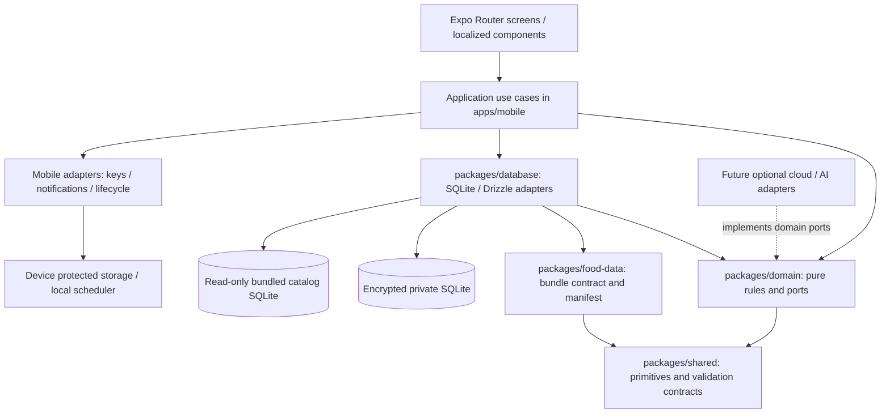
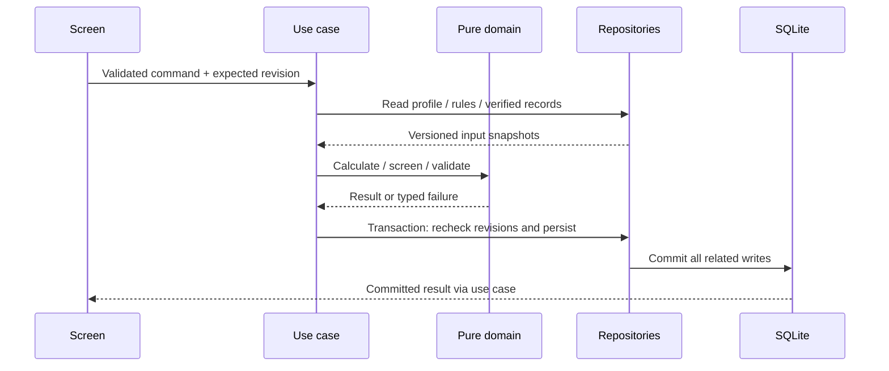

# DietMate BD — Technical Architecture

Phase 0.3 · Documentation review complete · 2026-11-13

Authority: [SRS v1.0](SRS.md), including FR-001–041, SYS-001–010 and AT-001–046; [PRD](PRD.md) Sections 6, 10, 11 and 14. This document specifies future implementation, not implemented controls or executed platform tests. No clinical parameters or production nutrition facts are supplied here.

## 1. Decisions and scope

Use a modular local application with React Native, Expo, TypeScript and Expo Router, SQLite through Drizzle, Zod at input boundaries, Zustand for transient UI state, and a pure TypeScript calculation engine. One device-local profile is supported in MVP. A household ownership root prepares later same-device family support without exposing multiple-profile UI.

Choose two SQLite files: an immutable public catalog and an encrypted private user database. This avoids duplicating the food dataset into private backups and keeps catalog replacement independent of personal migrations. Cross-file references are application-validated, not SQLite foreign keys. A single database would simplify joins but couple catalog distribution to private migrations; an online-first service would violate fresh-install offline requirements. No backend, account, subscription, paid AI, polling service or mandatory telemetry is introduced.

MVP includes daily templates and ingredient mappings, not a recipe/substitution product, pantry, barcode scanning, weekly/monthly automation, Ramadan enhancements, expanded activity tracking, exports, backup/restore, cloud or AI. These remain extensions under the PRD classifications. Readable export scope ambiguity SRS D-007 remains unresolved.

## 2. Components, layers and dependencies



Arrows indicate imports/dependencies except labeled storage/platform connections. `shared` imports no workspace package; `domain` imports only `shared`; `food-data` imports only `shared`; `database` imports `domain`, `food-data`, `shared`; `mobile` composes all packages. No package imports `mobile`; neither domain nor food-data imports database. Enforce this acyclic graph with import-boundary lint rules and TypeScript package exports. Domain has no Expo, React, Zustand, Drizzle, filesystem, locale or network dependency.

| Layer/module | Responsibility and permitted effects |
| --- | --- |
| UI | Accessible screens, form drafts, locale formatting, confirmation dialogs; calls use cases, never SQL or eligibility shortcuts. |
| Application | Profile, screening, log, daily planner, grocery, weight and reminder commands/queries; orchestrates ports, transactions and revision checks. Lives in mobile feature directories, separate from screens. |
| Domain | Immutable values, portion/nutrient/unit/money arithmetic, eligibility evaluation, template selection, grocery diff; typed results; repository, clock, ID, scheduler and optional provider ports. |
| Persistence | Drizzle schema/migrations, repositories, validated snapshot codecs, bundle lookup, serialized writes and transaction unit-of-work. No medical policy in SQL. |
| Platform | Protected key access, database bootstrap integration, permissions, notifications, app lifecycle; future file/crypto adapters only when commissioned. |
| Food data | Public versioned assets, bilingual names/search keys, sources/rights, verified mappings, reviewed templates/rules/guidance and release validation tooling. No private profile data. |

Feature services coordinate through application commands and domain values, not imports into each other's screens or Zustand stores. The application composition root injects concrete adapters; tests substitute in-memory ports.

## 3. Local-first flows and state



Startup opens protected storage and private SQLite, checks supported schema and integrity, performs offline migrations, validates the bundled manifest, then loads committed state and reconciles reminders. Catalog absence must produce an honest data-unavailable state and fails release acceptance; no fabricated or online fallback. Existing snapshots remain viewable if catalog lookup fails.

SQLite is the durable source of truth. Zustand holds navigation-adjacent UI filters, selected date, modal state and short-lived drafts only; no persisted duplicate health store or full catalog hydration. Repository queries return paginated projections; a small query hook reloads affected views after commit. Derived day totals are recomputed from immutable entry snapshots, not maintained as a second authoritative table. In-flight saves disable repeat submission and carry expected revisions to reject stale edits. Show success only after commit; cancellation and failed validation preserve prior records.

Proposed day policy (D-003 approval needed): persist `local_date`, occurrence UTC timestamp on logs and IANA timezone on logs/plans. Travel does not silently regroup history; moving an entry to a different day is an explicit edit. Clock/timezone are injected inputs. Profile age is entered in years with an as-of date; do not collect birth date solely for convenience. Reconfirmation behavior requires clinical/product approval.

## 4. Navigation, language and errors

Expo Router groups: `(onboarding)` for language/profile/screening; `(main)` tabs for Today, Foods, Plan/Groceries, Progress and Settings; nested routes for entry edits, weight history, screening and reminders. Bootstrap/recovery precedes both groups. Route parameters contain IDs/dates only, never health responses or full objects. Repositories revalidate ownership on route access. Restrictive-plan gates are in use cases, not merely route guards; logging remains reachable for triggered/incomplete screening.

Bundle Bangla and English strings, safety guidance and validation messages; Bangla remains LTR. Persist stable enum codes and canonical units; format numbers/dates/BDT at the UI edge. Require translated error/empty/permission screens, accessible labels, VoiceOver/TalkBack, 200% text and textual chart history.

Use discriminated failures: validation, unknown-data, eligibility-blocked, stale-revision, storage-full, key-unavailable, unsupported-schema, migration/integrity failure and notification failure. UI maps safe codes to localized guidance. Error boundaries handle unexpected UI failures; sensitive inputs/SQL parameters/keys never enter diagnostics. Corruption/key failures stop unsafe writes, preserve files and offer retry/help; never silently recreate or reset. No false save, delivery, recovery or medical-clearance claim.

## 5. Deterministic core engine contract

All functions take explicit data, policy versions, clock/date and stable ordering; no ambient time, random selection, network or mutable global state. Return values plus per-field completeness/reason codes. Use canonical decimal strings at persistence boundaries and exact base-10 rational arithmetic internally (integer coefficients/scales, reducing rationals); do not round intermediate nutrition/conversion values. Bound input length/scale and computation size for resource safety, without inventing clinical ranges. Half-up rounding to two decimals occurs only at specified presentation/cost boundaries. Serialize rationals as numerator/denominator strings where a finite decimal is impossible; version the snapshot codec and engine. Verify this arithmetic approach on the chosen JS runtime before implementation lock-in.

| Algorithm | Deterministic specification |
| --- | --- |
| Calories/macros | For each verified nutrient `n` on gram basis `b`, portion `g` contributes `n × g / b`. Energy uses the verified source energy value, never an invented reconstruction from macros. Unknown inputs stay unknown. Sum known contributions per nutrient, retaining missing-entry count; empty day has zero and no missing entries. Round final displayed nutrition half-up to two decimals. |
| Energy targets | Manual intake calculation above is ready to implement. Personalized energy expenditure, deficit formulas, macro target ratios and clinical bounds require approved versioned policy under D-001; absent policy returns target-unavailable and cannot authorize restrictive planning. Do not infer missing demographic inputs or adopt a generic formula. |
| Servings | Positive gram input passes directly; named serving requires a verified food-version/preparation-specific gram mapping: `grams = serving count × mapped grams`. Do not infer raw/cooked yield, density or household spoon sizes. Reject nonfinite/nonpositive/unsupported inputs. |
| Total/net carbohydrate | Total is default. Net is total minus fiber only if both are verified, same basis and compatible carbohydrate convention, and `0 ≤ fiber ≤ total`. Otherwise unavailable. No sugar-alcohol deduction. Aggregate known net separately with incompleteness indicators, never subtract unrelated daily partial totals. |
| Recipe aggregation (future domain contract) | Validate every component's verified record and exact edible quantity/preparation mapping; sum each nutrient and missing counts. Per-serving result divides by positive declared serving count; per-gram result requires verified final edible yield. Never infer cooking loss, water change or retention. MVP uses minimal template ingredient mappings, not recipe-library screens. |
| Daily planning | Re-evaluate current approved screening and configuration; filter approved templates by pattern, separate goal, verified portions, restrictions and complete allergen metadata. Stable-sort by approved priority then stable ID; choose using the approved versioned selection policy, without randomization or optimization service. Apply only approved portion/target policy; otherwise return unavailable. Validate edits on save/application. Persist exact selected meals, versions, eligibility/profile revisions and totals. No eligible template leaves old plan saved but unapplied if eligibility changed; offer logging. |
| Ingredient aggregation | Expand immutable meal ingredient mappings × portion multiplier. Group by stable ingredient ID and normalized compatible dimension/count-unit; g/kg and ml/l normalize within dimension. Cross-dimension or preparation conversions require an explicit verified mapping. Keep unresolved lines with original quantities/reasons; never omit them. Stable ID/unit ordering produces reproducible output. |
| BDT costs | Select compatible user price preferentially, otherwise bundled price, with latest effective date not after estimate date; ties use stable ID. Geography mismatch is disclosed, never silently substituted. `line = roundHalfUp(quantity / priceBasisQuantity × priceAmount, 2)`; sum line poisha integers. Include purchased items. Persist selected price/date/origin and calculation snapshot. Always disclose price age/date. D-004 must approve any stale-age label threshold; until then show dated-estimate limitations without inventing freshness or automatically treating old prices as zero. Coverage policy needs D-004 approval. |
| Unknown prices | Distinguish explicit zero from absent price or unavailable conversion. Return known subtotal plus unpriced/unconvertible line IDs and reasons. All missing yields no-known-prices, not a complete zero estimate. Manual search is local; invalid entry preserves valid prior price. |
| Screening gates | Validate complete responses against approved rule/question version and current profile revision. Outcomes: eligible-for-specified-automation, triggered, incomplete, unvalidated or stale; none means medical clearance. Only approved explicit eligibility and approved template policy may enable restrictive automation; all other outcomes block it and show bundled professional guidance. Screen onboarding and every pattern/goal application; profile, allergy/restriction, response or policy change invalidates eligibility and applied plans transactionally. All meal edits check restrictions; unknown allergen metadata prevents automatic selection. |

Plan edits increment plan revision and mark existing groceries stale. Regeneration computes a preview against that revision, showing additions, removals and quantity changes, including removed edited items. Preserve purchased status and overrides for surviving ingredient IDs/compatible unit buckets; changed overrides require explicit keep/reset. Cancellation changes nothing. Commit plan plus generated groceries together when replacing both; otherwise save plan with explicitly stale grocery status and regenerate in a later atomic command. Never present old groceries as current.

## 6. Offline notifications

Store desired schedule, wall time, timezone, recurrence, enabled state and revision in SQLite. Commit the desired change and reconciliation-pending marker atomically; OS calls cannot join a SQLite transaction. After commit, a serialized reconciler inspects pending OS requests, cancels superseded/duplicate requests and schedules one current occurrence with stable reminder/occurrence identity in request metadata. Persist request handle/status afterward. After a crash, reconciliation inspects OS state on restart to detect incomplete work rather than blindly adding requests; repair failures remain visible and retryable. Disabled/deleted reminders cancel pending requests; permission failure retains desired preferences and a visible error.

Prefer one OS-managed recurring request per reminder where the approved recurrence can be represented, so reminders do not require the app to reopen after each occurrence. For schedules requiring one-shot requests, a bounded horizon and replenishment limitations must be disclosed and tested; a single next-occurrence request cannot promise ongoing recurrence while the app stays closed. Reconcile after restart, edits, permission changes and detected timezone changes without continuous timers/network polling. Recurrence, DST nonexistent/ambiguous times, timezone-following behavior, platform request limits and supported OS versions need D-006 approval/testing. Notifications use generic content by default; no health details on lock screen. OS power restrictions can suppress/delay delivery; scheduling is not delivery confirmation.

## 7. Security and privacy decisions

Threat model: protect private database copies/backups and accidental disclosure; mitigate corrupt input and unintended transmission. An unlocked/rooted/jailbroken device, compromised application runtime or malicious OS can access decrypted data. No universal protection is claimed.

**Local encryption is an MVP release requirement, not implemented.** Preferred candidate: SQLCipher-enabled Expo SQLite native integration using the AES-256 target on Android and iOS, subject to current build/runtime support and licensing verification offline during implementation. Expect custom development/release builds rather than assuming Expo Go compatibility. Alternative: another maintained native SQLCipher binding if Expo integration fails; record added footprint and Drizzle compatibility. Standard unencrypted SQLite, OS sandboxing, whole-device encryption and field-only encryption do not by themselves satisfy FR-038's database encryption requirement.

Generate a random per-install database key with platform cryptographic randomness; never derive it from profile fields or bundle it. Candidate key protection: iOS Keychain with device-only accessibility and appropriate file protection; Android Keystore wrapping a random database key, potentially exposed through Expo SecureStore after native behavior verification. Do not assume SecureStore stores arbitrary keys directly in hardware or has identical lifecycle across platforms. Keep the unwrapped key in memory only as required by the SQLite connection, release on close where feasible, and exclude it from logs/crash data. JS memory erasure cannot be guaranteed. Verify encrypted DB, WAL/journal/temp-file behavior, key access before unlock, uninstall/reinstall, key invalidation, device migration and key rotation. Missing key means an explicit error/help state, never silent overwrite; permanent key loss may make data unrecoverable because MVP has no portable recovery feature. Rotation uses a validated new encrypted copy plus crash-safe activation; never discard the old key before new-copy verification.

Exclude private databases, sidecars and protected-key material from automatic OS/cloud backup until a verified coherent encrypted restore design exists. Verify Android backup/data-extraction rules and iOS backup exclusions and Keychain lifecycle in release builds. Public catalog requires integrity/rights validation, not secrecy. Use parameterized Drizzle queries, validated identifiers, bounded parsers and no arbitrary imported SQL. Minimize runtime permissions; notification permission only when enabling reminders. No API secrets in a mobile binary, no sensitive route parameters, clipboard use or diagnostic payloads.

Purpose-specific local consent defaults off. No MVP telemetry/network adapter is enabled. Future consent withdrawal stops queued/in-flight work where possible and forbids subsequent transmission; explain data already transmitted cannot be recalled merely by changing local consent. Profile deletion follows the retryable protocol in DATA_MODEL, including notification cleanup. Do not promise forensic erasure or deletion of exported copies.

### Release-blocking encryption verification gate (D-005)

Encryption feasibility is unresolved. Before personal-data implementation is accepted for release, the mobile/security owner must record the selected Expo SDK, native SQLite/SQLCipher and Drizzle adapter versions and results for every row below. No row is currently verified; failed feasibility requires a reviewed alternative, never plaintext fallback.

| Gate | Required evidence on supported Android and iOS release builds |
| --- | --- |
| Native/Expo compatibility | Native dependency/config-plugin/prebuild requirements, SQLCipher build flags and licensing recorded; custom development and release builds open encrypted SQLite through Drizzle. Expo Go is not assumed sufficient. |
| Protection | Confirm AES-256 configuration, copied DB unreadability with ordinary SQLite/wrong key, correct-key open, and private WAL/journal/temp/rollback-file protection. |
| Keys and recovery | Test first creation, locked-device access, protected storage, invalidated/missing key, reinstall/device transfer and backup exclusions. Record permanent-key-loss limitations and ensure no reset or false recovery promise. |
| Migration and rotation | Old supported encrypted schema migrates without plaintext intermediates; rollback/new-key activation survives interruption, wrong keys and full storage; original files and required keys remain preserved on failure. |
| Resource cost | Measure encrypted startup/query/write/migration latency, installed native-library size and peak RAM on the declared devices; compare SRS provisional benchmarks and record dispositions. |

### Future portable backups and restore (Post-MVP Offline)

Proposed versioned authenticated AES-256-GCM archive with fresh random salt/nonce and a user-managed passphrase. Candidate KDF: Argon2id with parameters benchmarked on supported low-memory devices; PBKDF2 only as an explicitly reviewed interoperability alternative. Mode, KDF/library, parameters, nonce strategy, archive size limits and key lifecycle are unresolved security decisions before this feature ships. Never reuse the device-bound DB key as the portable password key. No recoverable passphrase service is implied.

Create a consistent SQLite snapshot, include schema/engine/catalog-reference versions, manifest and checksums, encrypt/authenticate metadata, and avoid plaintext temporary files. Restore into a separate encrypted staging DB: bound size/decompression, authenticate before trusting content, validate checksum/version/Zod schemas, run integrity/FK checks, supported migrations, ownership and semantic constraints. Do not execute archive-supplied SQL. Wrong passphrase, tampering, unsupported versions or invalid data leaves active data unchanged. Retain a validated old copy until a crash-safe file activation protocol succeeds; close connections/checkpoint sidecars and use a durable recovery marker. Multi-file rename is not assumed atomic. Reconcile notification handles rather than restoring stale OS IDs. Fault tests must prove old/new recovery before shipping; no guaranteed automatic recovery.

### Future cloud and AI boundaries

No sync workers/tables/service are needed now. Future `SyncPort` transfers explicit versioned private aggregates only after separate opt-in and authentication; catalog distribution is a separate signed/versioned concern. Optional cloud encryption requires its own access-control, key recovery, multi-device membership/revocation and encrypted-metadata threat model. Client-side authenticated encryption with user-controlled keys is a candidate, not an implemented E2EE claim; server-at-rest encryption is a distinct control. PRD requires TLS 1.3 with certificate validation and rejection testing before any online feature ships.

Future `AiSuggestionPort` accepts a minimized consented request and returns untrusted food IDs/portion suggestions with provider metadata, cancellation and typed unavailable/error outcomes. No provider SDK in domain and no embedded provider secret; future credential service only if that feature is commissioned. Validate responses with Zod, resolve IDs against verified catalog, require user confirmation and run normal screening/log commands. AI cannot supply authoritative nutrients, prescribe targets or bypass gates. Disabled, missing or failed providers leave every offline flow usable.

## 8. Performance and quality

Use indexed prefix/search-key lookup for bilingual catalog names; bound result pages and avoid loading entire catalog into Zustand. Evaluate FTS only if measured search needs justify its footprint and Unicode behavior. Precompute public search keys, use virtualized lists, narrow SQLite projections, prepared/batched queries and bounded history windows. Avoid full dataset JSON parsing on every launch and heavyweight chart/state frameworks. Serialize writes; keep transactions short and prohibit network/OS calls inside them. Perform bounded expensive maintenance outside interactions, without persistent background loops.

Measure release builds against SRS provisional core <2s, installed <200MB, peak RAM <300MB, crash <0.1% and satisfaction >4/5 targets, with devices, OS, dataset, workload, denominator/period and disposition. These are unmeasured benchmarks, not guarantees or hard performance release gates. Encryption, bundle duplication, decimal arithmetic and catalog indexes must be included in size/RAM/timing measurements.

Automated strategy: domain unit/property tests for exact arithmetic, half-up boundaries, scaling, unknown propagation, permutation-invariant aggregation, raw/cooked isolation, net-carb compatibility, zero versus unknown prices, screening fail-closed and stable template selection. Use SRS synthetic N1/N2/G1 fixtures for arithmetic only, never as shipped facts; approved rule fixtures for safety. Repository tests use real SQLite migrations/FKs/rollback plus adapter failure injection; native encryption/key tests run on both platforms. UI tests cover both languages, inaccessible/empty/error states and screen-reader/text scaling. End-to-end tests execute AT-001–046, fresh airplane-mode installation through restart, denied permissions, edits/deletes, price gaps, migration/storage failures and notification reconciliation. Clock, IDs and provider ports are injectable. No network/UI/DB is needed for pure rule tests.

## 9. Implementation sequence and acceptance

Recommended structure (proposal only; no directories initialized):

```text
apps/mobile/             Expo Router app/, features/{profile,screening,log,planner,grocery,weight,settings}/
                         application/, adapters/{notifications,keys,lifecycle}/, composition/, locales/
packages/domain/         values/, nutrition/, planning/, grocery/, safety/, ports/, tests/
packages/database/       schema/{private,catalog}/, migrations/, repositories/, codecs/, tests/
packages/food-data/      manifests/, sources/, bundles/, validation/, reviewed-policies/
packages/shared/         identifiers/, validation/, result/, version-contracts/
```

1. Resolve D-001–006 affected contracts; establish package/import rules and test harness. Validate encrypted SQLite/Drizzle/key integration early on both platforms; failure cannot be deferred to release.
2. Build licensed catalog ingestion/validation and immutable manifest; establish exact arithmetic and provenance fixtures, professionally reviewed screening/templates and bilingual guidance.
3. Build private schema/migrations/repositories and encrypted bootstrap; test transaction, key, corruption, storage and revision failures.
4. Deliver bilingual onboarding/profile/screening plus verified food search/logging and restart, satisfying milestone 1 and tracking foundation.
5. Add editable daily planning, restriction gates, grocery preview/overrides and dated partial BDT estimates; then weight history/accessibility for milestone 2.
6. Add reminder reconciliation, consent/deletion and full offline acceptance, native security/resource evidence and all milestone 3 checks. No future provider infrastructure in this sequence.

Architecture acceptance: all FR-001–041 map to the modules and tests below; complete core runs with all online adapters absent; import graph has no cycles; historical snapshots remain stable after bundle upgrades; unknowns remain explicit; every restrictive apply path enforces approved current screening; encryption/key failures preserve files; commits and reminder reconciliation survive interruption; both locales/platforms pass core flows. Design review is not runtime acceptance.

| Coverage | Owning module / validation |
| --- | --- |
| FR-001,018–019 | Profile/configuration use cases; AT-001/018/019 |
| FR-002–003,020–025,041 | Food-data, domain nutrition, log repositories; AT-002/003/020–025/041 |
| FR-004–006,012–014,026–027,040 | Safety and daily planner; AT-004–006/012–014/026/027/040 |
| FR-007–009,028–031 | Grocery and price use cases; AT-007–009/028–031 |
| FR-010,032–033 | Weight; AT-010/032/033 |
| FR-011,017,034 | Notification adapter/reconciler; AT-011/017/034 |
| FR-015–016,035–039 | Persistence, localization and privacy; AT-015/016/035–039 |
| SYS/NFR | AT-042–046 plus milestone evidence |

Main tradeoffs: two databases lose cross-file FKs; immutable snapshots increase storage but protect history; encryption introduces native build and key-loss risk; precise arithmetic needs bounded inputs and runtime validation; SQLite single-writer serialization simplifies consistency but requires short transactions. Clinical review, verified data rights/coverage and reliable ingredient mappings are external release dependencies; no code architecture can substitute for them.

Open decisions: SRS D-001 clinical/formula/template approval; D-002 licensed dataset and actual coverage; D-003 enumerations/ranges/day semantics/age reconfirmation; D-004 geography/prices/mappings; D-005 concrete encryption/key/backup exclusion verification; D-006 OS matrix/recurrence/DST/measurement protocols; D-007 export scope. Additionally verify arithmetic representation, backup crypto/file activation design and future cloud key recovery before their affected capabilities ship. No medical threshold, macro ratio, caloric target or nutrition fact is invented by this design.

## 10. Review disposition and next actions

Phase 0.3 documentation verification is complete: layer/import direction, schema relationships, snapshots, unknown handling, safety boundaries and MVP scope have been reviewed against the SRS/selected PRD sections. No SQL schema generation, Mermaid rendering, native security test or runtime acceptance is claimed. Fixed design contracts are offline/no-account core use, pure domain calculations, database-owned durable state, versioned snapshots and fail-closed restrictive automation. Package layout and exact rational arithmetic are recommended implementation choices; platform integrations remain subject to evidence.

Next actions: qualified clinical reviewers resolve D-001; the data curator resolves D-002/004 with a rights/coverage manifest; the product owner resolves D-003/007; the mobile/security owner executes the D-005 gate and D-006 device/notification matrix. Record chosen versions, rationale and evidence in the affected design section before treating a pending decision as settled. Future archive/cloud decisions are deferred to their own release scopes. No app implementation has started.
