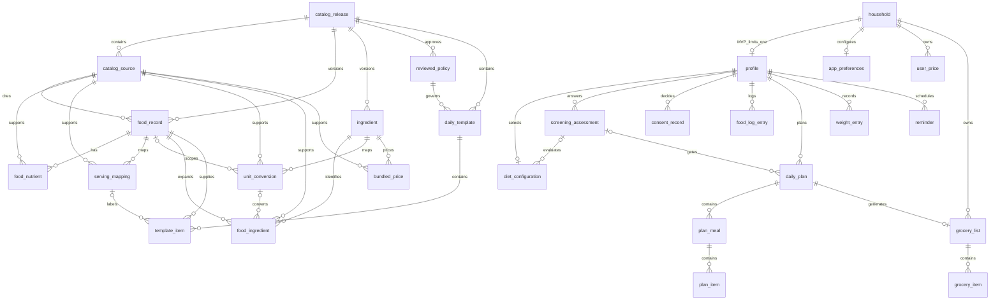

# DietMate BD — Data Model

Phase 0.3 · Documentation review complete · 2026-11-13

Authority: [SRS v1.0](SRS.md) and [PRD](PRD.md) Sections 6, 10, 11, 14. Companion: [ARCHITECTURE.md](ARCHITECTURE.md), including deterministic engine rules and security decisions. This is an implementation contract, not an initialized database or an encryption claim.

## 1. Storage split and conventions

**27 application entities: 12 public catalog tables and 15 encrypted private tables.** SQLite/Drizzle migration bookkeeping and SQLite internal tables are excluded from this count. All 27 are MVP-required in this recommended schema, including minimal ownership and consent support; none is a future-only table. Future entities are not included or required for MVP.

`catalog.sqlite` is a bundled immutable public artifact, installed/read through a read-only connection. `private.sqlite` contains user records and is required to use verified AES-256 database encryption before MVP release. Never attach private data to an unencrypted writable catalog connection. Separate files mean SQLite cannot enforce cross-file foreign keys: catalog references below marked **REF** are validated by application repositories against the exact release before commit. Private snapshots preserve history if an older bundle is unavailable. Native private FKs use `PRAGMA foreign_keys=ON` on every connection, verified in adapter tests. No connection opens for normal writes before key/schema checks succeed.

Table notation: `PK`, `FK`, `UQ`, `?` nullable; every other field is NOT NULL. IDs are application-generated opaque text IDs from an injected generator (random secure IDs in production); never derived from health data. Catalog IDs are stable within an entity and versions are immutable. Private owned tables carry `created_at`, `updated_at` UTC integer milliseconds and `revision` positive integer (initial 1). Append-only screening/consent still carry these common fields for uniform codecs. Catalog tables do not carry private lifecycle fields.

Canonical quantities/nutrients/prices are exact decimal TEXT validated by Zod and exact arithmetic, not SQLite REAL. A DEC field is a bounded canonical decimal string; engine outputs that require rational precision use versioned numerator/denominator string objects in snapshots. SQLite CHECKs enforce basic nonempty/type rules; application schemas enforce decimal grammar, sign, finite interpretation, precision/size and positive denominators. Never trust lexical TEXT comparison as a numeric constraint. Integer fields have CHECK bounds appropriate to their engineering type; medical ranges are not invented. Money line totals use nonnegative integer poisha, checked for safe integer overflow. BDT unit prices can have fractional precision; round only computed lines. Booleans are INTEGER CHECK IN (0,1); enums use CHECK IN lists once approved.

All JSON fields are TEXT with `CHECK(json_valid(field))`, explicit codec/schema version and bounded Zod validation; use only if selected SQLite build supports JSON validation, otherwise an equivalent adapter check is a required compatibility decision. Lists of clinical answers/preferences are intentionally bounded JSON for a solo-developer schema, not arbitrary executable rules. Queries needing relational identity use proper tables. Use parameterized statements, not JSON-generated SQL.

## 2. Public catalog schema (12)

All `FK table` field shorthand below expands to `(release_id,field) REFERENCES table(release_id,id)` for catalog child references; nullable IDs retain the non-null release scope. Additional same-food/ingredient compatibility constraints are validated by the bundle validator. Composite catalog identity is `(release_id, id)` unless specified otherwise. Every child carries `release_id FK catalog_release.id`; same-release composite FKs prevent mixed artifact references. Catalog FKs use ON DELETE/UPDATE RESTRICT; releases are replaced as complete validated files, not mutated at runtime.

| Entity | Release scope | Fields and keys | Constraints / meaning |
| --- | --- | --- | --- |
| `catalog_release` | MVP required | `id PK`, `schema_version INTEGER`, `dataset_version TEXT UQ`, `published_at INTEGER`, `manifest_hash TEXT`, `validation_status ENUM`, `coverage_json JSON`, `license_manifest_json JSON` | One active release per file. Manifest enumerates actual count, coverage, rights and hashes; no assumed food count. Hash verified against trusted packaged manifest, not only a hash stored inside the same file. |
| `catalog_source` | MVP required | `release_id`, `id`, `title TEXT`, `publisher TEXT`, `source_version TEXT`, `citation TEXT`, `rights_status ENUM`, `license_ref TEXT`, `suitability_status ENUM`, `reviewed_at INTEGER`, `review_ref TEXT`; composite PK | Only approved suitability/redistribution statuses ship. Source citation is not permission. |
| `food_record` | MVP required | `release_id`, `id`, `food_key TEXT`, `record_version TEXT`, `source_id FK catalog_source`, `name_bn TEXT`, `name_en TEXT`, `search_bn TEXT`, `search_en TEXT`, `preparation ENUM`, `basis_grams DEC`, `carb_convention ENUM`, `verification_status ENUM`, `allergen_json JSON`, `restriction_json JSON`, `metadata_completeness ENUM`; composite PK | UQ `(release_id,food_key,record_version,preparation)`; basis positive; raw/cooked/other reviewed state explicit. Allergen metadata distinguishes known absent from unknown; no safety guarantee. |
| `food_nutrient` | MVP required | `release_id`, `food_id FK food_record`, `nutrient_code ENUM`, `value DEC?`, `unit ENUM`, `verification_status ENUM`, `source_id FK catalog_source`; PK `(release_id,food_id,nutrient_code)` | Codes: energy_kcal, protein_g, fat_g, total_carbohydrate_g, fiber_g. Explicit NULL is unknown, not zero; missing row also unknown. Values nonnegative when known; units match code. Basis inherited from food. |
| `serving_mapping` | MVP required | `release_id`, `id`, `food_id FK food_record`, `serving_code TEXT`, `label_bn TEXT`, `label_en TEXT`, `grams DEC`, `source_id FK catalog_source`, `verification_status ENUM`; composite PK | UQ `(release_id,food_id,serving_code)`; grams positive; no cross-preparation reuse. |
| `ingredient` | MVP required | `release_id`, `id`, `ingredient_key TEXT`, `name_bn TEXT`, `name_en TEXT`, `preparation ENUM`, `allergen_json JSON`, `restriction_json JSON`, `metadata_completeness ENUM`; composite PK | UQ `(release_id,ingredient_key)`; the stable key includes preparation identity; canonical grocery identity includes preparation where relevant. Names never serve as merge keys. |
| `unit_conversion` | MVP required | `release_id`, `id`, `ingredient_id FK ingredient`, `food_id FK food_record?`, `from_unit TEXT`, `to_unit TEXT`, `factor DEC`, `source_id FK catalog_source`, `verification_status ENUM`, `mapping_kind ENUM`; composite PK | Positive factor; density/count/yield mappings specific to ingredient/preparation and optionally food. UQ on identity/from/to/kind with explicit handling of NULL food ID via partial indexes. Conflicting mappings fail bundle validation. Basic g/kg, ml/l factors belong to engine unit definitions. |
| `food_ingredient` | MVP required | `release_id`, `id`, `food_id FK food_record`, `ingredient_id FK ingredient`, `quantity DEC`, `unit TEXT`, `food_basis_grams DEC`, `conversion_id FK unit_conversion?`, `verification_status ENUM`, `source_id FK catalog_source`; composite PK | Positive quantities/basis. Mapping expands a food portion to grocery inputs; never infer cooked-to-raw purchasing yield. Missing mapping becomes an unresolved grocery line. |
| `daily_template` | MVP required | `release_id`, `id`, `template_version TEXT`, `pattern ENUM`, `energy_goal ENUM?`, `priority INTEGER`, `policy_id FK reviewed_policy`, `label_bn TEXT`, `label_en TEXT`, `parameters_json JSON`; composite PK | Pattern Keto/Low-Carb/Balanced; goal NULL or Calorie Deficit code. No fourth diet pattern. Only approved policy/parameters may ship. |
| `template_item` | MVP required | `release_id`, `id`, `template_id FK daily_template`, `meal_key TEXT`, `meal_order INTEGER`, `item_order INTEGER`, `food_id FK food_record`, `grams DEC`, `serving_id FK serving_mapping?`; composite PK | Positive grams; UQ `(release_id,template_id,meal_order,item_order)`; serving must reference same food. Bundle validation checks meal restrictions and mapping coverage. |
| `reviewed_policy` | MVP required | `release_id`, `id`, `policy_version TEXT`, `kind ENUM`, `definition_json JSON`, `guidance_bn TEXT`, `guidance_en TEXT`, `reviewer_qualifications TEXT`, `review_ref TEXT`, `approved_at INTEGER?`, `approval_status ENUM`, `risk_assessment TEXT`; composite PK | Kind screening/template/energy/macro/age. Definitions use a bounded declarative DSL interpreted locally, not eval. Missing/unapproved policy cannot authorize automation. Material changes require new approval/version. |
| `bundled_price` | MVP required | `release_id`, `id`, `ingredient_id FK ingredient`, `amount_bdt DEC`, `basis_quantity DEC`, `unit TEXT`, `price_date TEXT`, `geography TEXT`, `source_id FK catalog_source`, `origin TEXT CHECK 'bundled'`; composite PK | Amount nonnegative including explicit zero; basis positive; validated ISO date; source/date/geography displayed. Price is estimate input, not a promise of market availability. |

Index catalog food search keys separately `(release_id,search_bn,id)` and `(release_id,search_en,id)` for bounded prefix lookups; validate Bangla normalization and query plan. Add indexes for every child FK prefix, `(release_id,food_id)` serving/mapping lookups, `(release_id,pattern,energy_goal,priority,id)` templates and `(release_id,ingredient_id,price_date,id)` prices. Avoid redundant indexes already covered by PK/UQ. FTS is optional after measurement, not a thirteenth required entity.

## 3. Private schema (15)

Private FKs default `ON DELETE RESTRICT`. Profile-owned aggregate deletion is explicit in one transaction, avoiding accidental broad cascades. Child tables also carry profile/household ownership where needed to enforce isolation using composite FKs. Each referenced parent exposes the corresponding `(owner_id,id)` UQ; parent IDs are globally unique but ownership must still match. Nullable FKs require paired-null checks where applicable.

| Entity | Release scope | Fields beyond common fields | Constraints / relationships |
| --- | --- | --- | --- |
| `household` | MVP required | `id PK`, `label TEXT?`, `lifecycle ENUM(active,deletion_pending)`, `deletion_state_json JSON?` | UQ expression index on constant limits root rows to one in MVP. Label optional; no family members/accounts added. Deletion state retains only cleanup IDs/status, not screening answers. |
| `profile` | MVP required | `id PK`, `household_id FK household`, `age_years INTEGER`, `age_as_of TEXT`, `height_cm DEC`, `current_weight_kg DEC`, `activity_code TEXT`, `goals_json JSON`, `preferences_json JSON`, `restrictions_json JSON`, `allergies_json JSON` | UQ `(household_id,id)`; UQ `household_id` enforces exactly at most one MVP profile; onboarding transaction creates one. Age required with clinically governed eligibility separately pending; measurements positive. Enumerations/clinical ranges D-003 pending; invalid saves leave old row intact. Current weight is explicit profile input; weight-history commands may explicitly update it and invalidate eligibility in the same transaction. |
| `app_preferences` | MVP required | `id PK`, `household_id FK household UQ`, `locale ENUM(bn,en)`, `weight_unit ENUM(kg,lb)`, `day_timezone TEXT`, `settings_json JSON` | Unit display never changes canonical storage. First-launch locale can remain transient until root creation; no pre-profile private table required. Unknown future JSON keys rejected until codec upgrade. |
| `diet_configuration` | MVP required | `id PK`, `profile_id FK profile UQ`, `pattern ENUM`, `energy_goal ENUM?`, `eligibility_status ENUM`, `screening_id FK screening_assessment?`, `evaluated_profile_revision INTEGER?`, `policy_refs_json JSON` | Same three patterns and separate deficit goal. UQ `(profile_id,id)`. Allowed configurations validated before writes; current eligibility binds profile/assessment/policy versions. Screening reference must share profile via composite FK. |
| `screening_assessment` | MVP required | `id PK`, `profile_id FK profile`, `profile_revision INTEGER`, `catalog_release_ref TEXT REF`, `policy_refs_json JSON`, `policy_snapshot_json JSON`, `answers_json JSON`, `outcome ENUM`, `reason_codes_json JSON`, `assessed_at INTEGER` | UQ `(profile_id,id)`; immutable assessment. Eligible-for-specified-automation/stale/triggered/incomplete/unvalidated outcome encoded without diagnosis. Snapshot includes question versions and approval references. No cloud identifier or unnecessary medical free text. |
| `consent_record` | MVP required | `id PK`, `profile_id FK profile`, `purpose_code TEXT`, `notice_version TEXT`, `granted BOOLEAN`, `decided_at INTEGER` | Append-only purpose-specific decisions; latest `(decided_at,id)` is effective; choose local decided_at monotonically per purpose inside the serialized transaction, even if device time moves backward. No row means off. Optional telemetry/cloud/AI never activated merely by having a consent row; capability must exist and be explicitly enabled. |
| `food_log_entry` | MVP required | `id PK`, `profile_id FK profile`, `local_date TEXT`, `occurred_at INTEGER`, `timezone TEXT`, `meal_code TEXT`, `catalog_release_ref TEXT REF`, `food_ref TEXT REF`, `portion_input_json JSON`, `grams DEC`, `nutrition_snapshot_json JSON`, `engine_version TEXT` | Positive grams; ISO day and IANA zone validated. Snapshot contract below mandatory. Editing replaces entry snapshot and increments revision; deleting requires UI confirmation. No daily-summary table: aggregate from committed snapshots. |
| `daily_plan` | MVP required | `id PK`, `profile_id FK profile`, `local_date TEXT`, `timezone TEXT`, `configuration_snapshot_json JSON`, `screening_id FK screening_assessment?`, `profile_revision INTEGER`, `catalog_release_ref TEXT REF`, `template_refs_json JSON`, `policy_snapshot_json JSON`, `status ENUM(draft,applied,unapplied)`, `totals_snapshot_json JSON`, `engine_version TEXT` | UQ `(profile_id,local_date)` and `(profile_id,id)`; same-profile screening. Applied state requires current approved eligibility rechecked transactionally. Old snapshots retained when state changes to unapplied. |
| `plan_meal` | MVP required | `id PK`, `profile_id`, `plan_id`, `meal_code TEXT`, `position INTEGER` | Composite FK `(profile_id,plan_id)` to daily_plan; UQ `(profile_id,id)`, UQ `(plan_id,position)`. Positions nonnegative; no empty implicit meal substitution. |
| `plan_item` | MVP required | `id PK`, `profile_id`, `meal_id`, `position INTEGER`, `catalog_release_ref TEXT REF`, `food_ref TEXT REF`, `grams DEC`, `portion_input_json JSON`, `nutrition_snapshot_json JSON`, `ingredient_snapshot_json JSON` | Composite FK `(profile_id,meal_id)` to plan_meal; UQ `(meal_id,position)`; positive grams. Ingredient snapshot preserves verified mappings or explicit unresolved reasons. Each command validates restrictions against current profile. |
| `grocery_list` | MVP required | `id PK`, `household_id FK household`, `profile_id`, `plan_id`, `source_plan_revision INTEGER`, `state ENUM(current,stale)`, `estimate_date TEXT`, `estimate_snapshot_json JSON`, `engine_version TEXT` | Composite FK `(household_id,profile_id)` to profile and `(profile_id,plan_id)` to daily_plan; UQ `plan_id`, UQ `(household_id,id)`. MVP one list per plan; household root supports later family aggregate design without enabling it. |
| `grocery_item` | MVP required | `id PK`, `household_id`, `list_id`, `line_key TEXT`, `ingredient_key TEXT? REF`, `catalog_release_ref TEXT? REF`, `unit TEXT`, `generated_quantity JSON?`, `override_quantity DEC?`, `purchased BOOLEAN`, `override_review_required BOOLEAN`, `resolution ENUM`, `origin_snapshot_json JSON`, `price_snapshot_json JSON?`, `line_poisha INTEGER?` | Composite FK `(household_id,list_id)` to grocery_list; UQ `(list_id,line_key)`. Generated quantity uses the exact rational codec to preserve division/yield precision; resolved generated quantity positive; override permits explicit zero to omit purchase need; unknown cannot masquerade as zero. Known line_poisha nonnegative. Unresolved line has stable plan-item/mapping-derived key and original quantity/reason in origin snapshot; catalog reference pairs null together. |
| `user_price` | MVP required | `id PK`, `household_id FK household`, `catalog_release_ref TEXT REF`, `ingredient_key TEXT REF`, `ingredient_snapshot_json JSON`, `amount_bdt DEC`, `basis_quantity DEC`, `unit TEXT`, `currency TEXT CHECK 'BDT'`, `price_date TEXT`, `geography TEXT`, `origin TEXT CHECK 'user'` | Ingredient snapshot preserves name/preparation/identity if catalog entry disappears. Nonnegative amount including zero, positive basis, supported unit; keep dated prior rows for FR-030. No price-history analysis feature implied. Correction adds new row; effective selection uses date then ID under documented policy. |
| `weight_entry` | MVP required | `id PK`, `profile_id FK profile`, `occurred_at INTEGER`, `timezone TEXT`, `kg DEC`, `input_unit ENUM(kg,lb)` | Positive kg and valid timestamp. No uniqueness on timestamp: two legitimate observations allowed; ties ordered by ID. Confirmed edits/deletes preserve old state on failure. Conversion is exactly 1 lb = 0.45359237 kg; display two decimals only. |
| `reminder` | MVP required | `id PK`, `profile_id FK profile`, `kind ENUM(meal,water,activity)`, `enabled BOOLEAN`, `wall_time TEXT`, `timezone TEXT`, `recurrence_json JSON`, `schedule_revision INTEGER`, `reconcile_pending BOOLEAN`, `os_requests_json JSON`, `last_status ENUM`, `last_error_code TEXT?` | Wall time HH:mm and timezone validated. OS handles/occurrence keys are bounded metadata, not proof of delivery. Revision identifies desired state; one current pending occurrence per enabled reminder. Recurrence/DST policy awaits D-006. |

Indexes: `food_log_entry(profile_id,local_date,occurred_at,id)`; `screening_assessment(profile_id,assessed_at,id)`; `consent_record(profile_id,purpose_code,decided_at,id)`; `weight_entry(profile_id,occurred_at,id)`; `user_price(household_id,ingredient_key,price_date,id)`; `reminder(profile_id,enabled)` and partial pending-reminder index; plan and grocery child FK indexes. Add indexes for uncovered ownership FKs, but not redundant PK/UQ prefixes. Daily-plan UQ supplies day lookup. SQL checks enforce enum and integer bounds; domain validation covers referenced catalog semantics, finite numbers, dates, current policy and allergies. Tests must exercise both paths.

`diet_configuration` points to screening, but screening does not reference configuration: create assessment first, then attach it within the same transaction. This avoids a required-insert cycle. No clinical parameter is encoded as a database CHECK.

## 4. Relationships

Catalog release ownership FKs also apply to every catalog child as specified above; the diagram omits repeated release edges for legibility. Cross-file REF values deliberately have no ER FK edge. Nullable screening edges permit drafts, never applied restrictive plans without valid assessment.

## 5. Snapshot/provenance contract

A nutrition snapshot contains codec/engine version, release/food stable ID and record version, source citation/version, verification status, preparation, positive nutrient gram basis, carbohydrate convention, exact input portion and mapping version, original known/unknown nutrient values and units, exact contributions, missing reasons and calculation policy version. Sources can differ per nutrient and must be retained. Calculation snapshots are immutable until an explicit entry edit; never recalculate old entries using the latest catalog implicitly.

Plan snapshots also include reviewed template/policy versions and approval references, profile revision, ingredient/allergen metadata with completeness, and per-nutrient totals/missing counts. Price snapshots retain amount, currency, basis/unit, source/origin, geography, effective date, selected conversion references and line rounding rule. Store exact rational values, not just rounded display text. Validate all snapshot codecs on read; malformed data raises an integrity error rather than turning unknown into zero.

Catalog upgrades introduce new immutable releases. Keep stable ingredient keys for known semantic continuity; a changed meaning needs a new key or reviewed mapping. Install/validate new artifact before switching the active in-memory catalog handle. Old historical snapshots need no old file to remain readable. An edit requiring an unavailable old mapping must obtain an explicit verified replacement and create a new snapshot, or remain unsaved. No guessed ID remapping. New logs use the new release; old totals remain unchanged.

### Cross-file consistency and catalog deletion

There is no atomic write transaction spanning catalog and private files, and none is needed: the catalog is immutable while a command runs and only the private connection writes. Pin the validated catalog release handle, resolve REF IDs/stable preparation-specific ingredient keys, validate the record and copy all required snapshots before the private transaction commits. A missing reference rejects new calculation writes without altering prior private rows. A failed private transaction rolls back independently; the catalog remains unchanged.

Catalog activation validates its manifest/schema/rights and compatibility first, quiesces commands, then switches the read handle. On a failed install/activation keep the old validated artifact; never change private schema/version metadata to pretend catalog activation succeeded. On restart, validate installed bundled assets again; no cross-file commit marker is interpreted as a completed personal-data migration. A changed policy release invalidates cached eligibility before any restrictive apply command, regardless of previously persisted status.

Deleted/withdrawn catalog records do not cascade into private data: logs/plans/groceries/prices remain readable from their snapshots, with source/version and withdrawn/unavailable status disclosed. No silent nutrient recalculation, raw/cooked substitution or price reassignment is allowed. New selection/application requires current verified mappings and policy; unresolved items remain explicit. A legacy user price cannot match a new preparation/key without reviewed identity continuity. Failed migration prevents unsafe writes and preserves private rows/files; interrupted private writes expose only the prior or complete new transaction, never dangling partial children.

## 6. Ownership and future expansion

MVP service and SQL UQs enforce one household and at most one profile, with full creation atomic. Household is a local ownership scope, not an account or shared network identity. Every private query is scoped by current owner; arbitrary route IDs cannot cross profiles. Future same-device family support removes the `profile.household_id` UQ in a reviewed migration, adds profile selection and extends shared grocery sources to a join table. Existing profiles/logs retain IDs and ownership. Household restrictions/allergies must be evaluated per eater before shared planning; no automatic safe household merge.

Post-MVP extension tables (not in the 27): recipe/version/components, shared-grocery plan sources, pantry/inventory, barcode and extended activity records. Optional future capability tables (not in the 27): sync outbox/tombstones/device membership and cloud identity metadata. Do not create these during MVP; add only via approved feature migrations. Portable backups need an archive format, not an MVP backup table. The existing household row is only a local ownership/deletion root, not implemented family support; consent_record supports mandatory local consent controls without creating any online service.

Recipes later add private recipe/version/ingredient entities or public catalog equivalents; pantry, barcode, activity, Ramadan, weekly planning and sync add their own migrations only when commissioned. MVP plan-item ingredient snapshots are sufficient for daily grocery generation and do not require recipe-library infrastructure.

## 7. Transactions and concurrency

Use a serialized writer and Drizzle unit-of-work with explicit BEGIN/COMMIT/ROLLBACK. Recheck expected revisions, ownership, current profile/assessment and catalog handle before committing a calculation prepared outside the transaction. Freeze the catalog handle during a command; the catalog is immutable. No OS calls, network, unbounded computation or permission dialogs inside transactions.

| Command | Atomic private mutation |
| --- | --- |
| Onboard/edit profile | Household/profile/preferences plus initial config/assessment as available; any safety-relevant change invalidates config eligibility and marks affected plans unapplied. Existing groceries become stale if their plan validity changes. |
| Screen/apply pattern or goal | Insert immutable assessment, validate current profile/rules, update config and affected plan application states together. Invalid input leaves previous config unchanged; safety invalidation remains enforced after a genuine profile change. |
| Log add/edit/delete | Validate and mutate entry; day totals queried after commit from snapshots, so no stale summary row exists. Cross-day edit invalidates both day views. |
| Plan edit | Parent revision, child meals/items and totals; mark existing grocery list stale in same commit. Recheck restrictions on every save/application. |
| Plan/grocery replacement | Preview outside transaction, then verify plan/list revisions; require override keep/reset/removal decisions; replace linked rows and estimate together. Cancel makes no writes. Retain surviving status/overrides by ingredient key and compatible normalized unit bucket, never ambiguous name. |
| Price save | Insert valid dated price; affected estimates remain reproducible from snapshots until explicit recalculation, visibly dated. Reject bad input without replacing prior values. |
| Weight command | Entry edit/delete and any explicitly requested current-profile weight update/invalidation together. |
| Reminder mutation | Desired schedule/revision and reconciliation marker together; OS side effects follow the recoverable protocol in ARCHITECTURE. |
| Consent decision | Record decision; future queued transmission cancellation must share a transaction with withdrawal once such queues exist. No queue is created for MVP. |

Transaction interruption must yield prior or complete new committed state. Use revision-checked UPDATEs (`WHERE revision = expected`) and reject zero affected rows as stale edits. SQLite journaling/synchronous configuration must be validated with the encryption binding, including crash/disk-full tests; do not trade durability for a benchmark. No SQL aggregate arithmetic on decimal TEXT or JSON rounded display values.

## 8. Migrations and integrity

Drizzle generated/reviewed migrations are bundled, ordered and checksum-versioned, with schema version checked before writes. Maintain separate catalog/private schema tracks; bookkeeping is implementation metadata outside the 27 entities. Do not run destructive autogenerated changes without review. On every open enable FKs and verify supported schema; perform lightweight integrity checks, fuller integrity/FK checks after migration or suspicious failure. Unsupported/newer schema or unavailable key stops unsafe writes and preserves bytes.

Before migration establish sufficient free storage and a consistent encrypted rollback copy using a verified snapshot mechanism, handling WAL/sidecars coherently; if preparation fails, do not mutate the original. Run supported transactional DDL/data changes in one transaction per reviewed upgrade path; validate schema, row counts, snapshots, FKs and semantic invariants before committing version metadata. For changes requiring file replacement use staging and the durable activation/recovery-marker protocol, not a claimed atomic series of renames. Never store plaintext rollback copies. Keep old copy until successful verification/activation; report failures without silent reset. Tests cover each supported prior version, interruption around commit/activation, full disk, corrupt rows, wrong/missing keys and newer-schema rejection. Migration checksums detect unexpected local migration changes, not an independently trusted malicious-device defense.

Portable restore remains post-MVP. Authenticate/decrypt into bounded encrypted staging, reject unsupported archive/codec/schema/catalog references that lack valid snapshots, migrate supported staging versions, validate integrity/FKs/ownership/semantics, then activate with recovery marker while preserving old data. Never import arbitrary SQL or trust a checksum without authenticated integrity. Wrong passphrase/corruption/unsupported versions leave original usable. Backup includes private data plus required provenance snapshots/manifests, not device keys or reusable OS notification handles. Reconcile notifications after activation. Crypto choices and crash-safe activation require implementation verification; no encryption/restore is currently implemented.

## 9. Future sync metadata and conflicts (deferred)

Stable private IDs, ownership, revisions and immutable calculation snapshots prepare optional sync without building it. Current timestamps are not a reliable multi-device order. Do not add accounts, remote IDs, tombstones, workers or a server now.

When sync is explicitly commissioned, migrate to add entity-version/base-version metadata, device identity, tombstones and a transactional outbox; enable only after purpose-specific consent and authentication. Sync private aggregates, never mutable public catalog rows. Define server/client protocol and encryption/key recovery separately. Proposed conflicts: append independent weight/log entries by globally unique ID; same-entry edits/deletes require base-version comparison with visible resolution, with tombstones preventing resurrection. Plans and grocery lists resolve at aggregate revision, never field-merge meal/portion/override fragments. Concurrent user prices coexist as observations. Never use last-write-wins for screening eligibility, allergies, consent or deletion; re-evaluate screening locally from current data and approved policy after merges, and withhold restrictive automation until resolved. Revocation/deletion must stop uploads; deletion dominance and remote purge/retention acknowledgements need a specified protocol before sync ships. Logical clock/version design and conflict UX are unresolved future decisions.

## 10. Retention and deletion

Keep logs, plans, weights, user prices, assessments and consent decisions locally until user edits/deletes or confirms full local deletion; no indefinite server retention exists. Historical assessment/approval snapshots are retained only to explain applied decisions, not for analytics. Additional age-based retention/auto-pruning requires an explicit policy; no unapproved clinical history collection is added. Keep only one active shipped catalog artifact after successful upgrade unless a verified rollback process temporarily needs another; snapshots preserve provenance. Expire bounded temporary encrypted migration copies after verified success under an explicit cleanup policy.

Full deletion is a retryable local protocol because SQLite and OS scheduling cannot commit together:

1. Confirm deletion; first persist a durable platform cleanup marker containing only database-generation and cleanup phase, never health values or keys; clear it only after final file/key cleanup succeeds. This recovery metadata is not another application entity. Then persist household `deletion_pending` and minimal known notification cleanup identities. Block normal edits and reminder re-creation.
2. Cancel/enumerate DietMate pending OS requests, including requests created before a prior crash. If cancellation fails, retain pending state and report incomplete deletion for retry; never claim completion.
3. In a transaction delete reminder rows and every private owned child in FK order (config before assessments, grocery children/lists before plan children/plans, all log/weight/consent/price/preferences records), then profile and household. No personal diagnostic data is retained.
4. Close/checkpoint and execute verified encrypted-file/key cleanup or empty-database reinitialization protocol as appropriate; ensure old sidecars/rollback copies cannot resurrect records. Only return to fresh onboarding after successful data and notification cleanup. A crash resumes the platform cleanup marker and durable pending state or verifies completed empty state; missing keys/files with residual schedules is an error requiring cleanup, not silent success.

Individual log/weight deletes require explicit confirmation; invalid edits never lose saved values. SQLite DELETE/VACUUM and key destruction cannot guarantee forensic erasure on flash storage; separately exported files, OS backups and future transmitted copies require their own deletion controls. Encryption key lifecycle and automatic backup exclusion must be verified on Android/iOS before release. Retention of internal rollback copies must not defeat user deletion.

## 11. Design validation and outstanding decisions

Design trace: profile/configuration → FR-001/018/019; catalog/provenance/nutrition snapshots → FR-002/003/020–024/041; log mutations → FR-025; plans/policies → FR-004–006/012–014/026–027/040; ingredients/groceries/prices → FR-007–009/028–031; weight → FR-010/032–033; reminders → FR-011/017/034; schema/transactions/privacy → FR-015/016/035–039. Architecture test strategy covers SRS AT-001–046; no application tests have been executed in this documentation phase.

Review acceptance: no mandatory backend/account; explicit unknown values; versioned verified inputs; no circular package imports; one-profile MVP with expandable ownership; private/canonical catalog separation; native and cross-file relationship validation; atomic mutations and durable OS reconciliation; no invented nutrition values or medical thresholds. Entity/schema design is specified, not yet validated by generated SQL or a native SQLite runtime.

Unresolved: SRS D-001 professional clinical/formula/template approval; D-002 rights and verified food/serving/preparation coverage; D-003 enums/ranges/day policy/age reconfirmation; D-004 ingredient/price geography and selection coverage; D-005 encryption implementation/key lifecycle/backup exclusion; D-006 OS/notification/DST/device evidence; D-007 readable export scope. Verify native SQLite JSON/encryption/Drizzle support and exact arithmetic codec/resource limits during implementation. Future portable archive KDF/mode/parameters/file activation and cloud conflict/key recovery policies remain gated separately. Pending review cannot authorize restrictive automation or a public-release claim.

Documentation review complete; implementation validation remains pending. Execute ARCHITECTURE D-005 encryption gate before release, and resolve the named D-001–007 owners/actions before affected behavior is considered settled.
