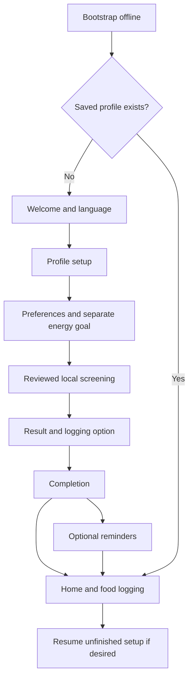
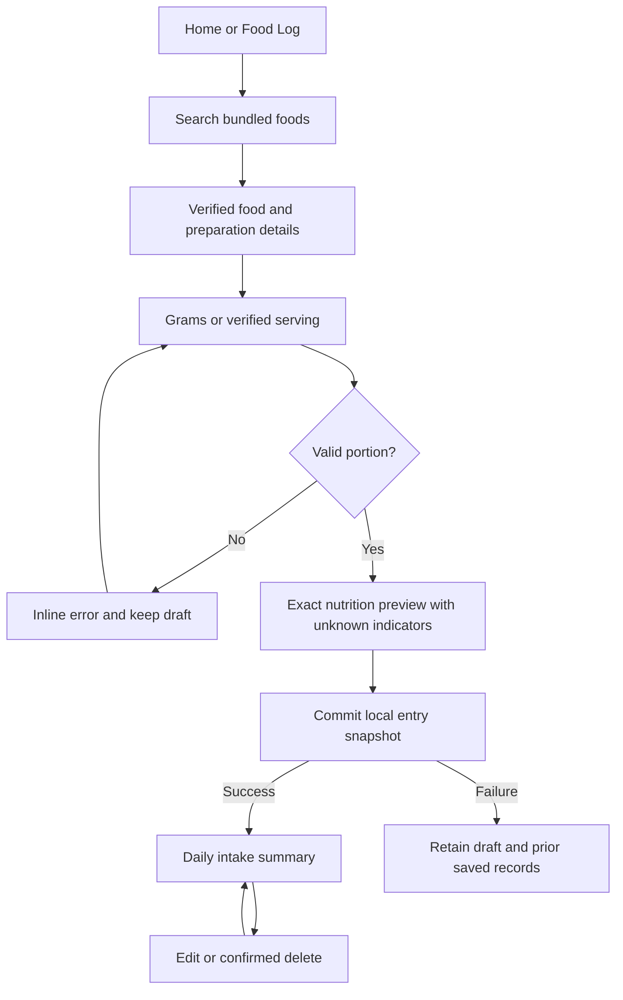
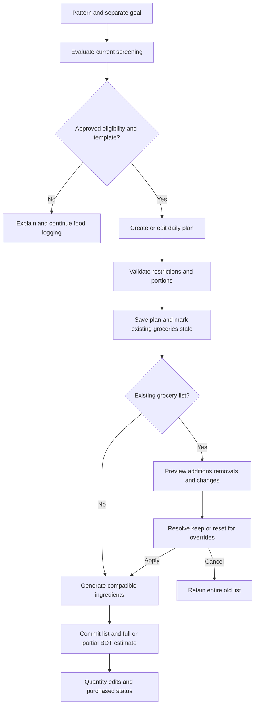
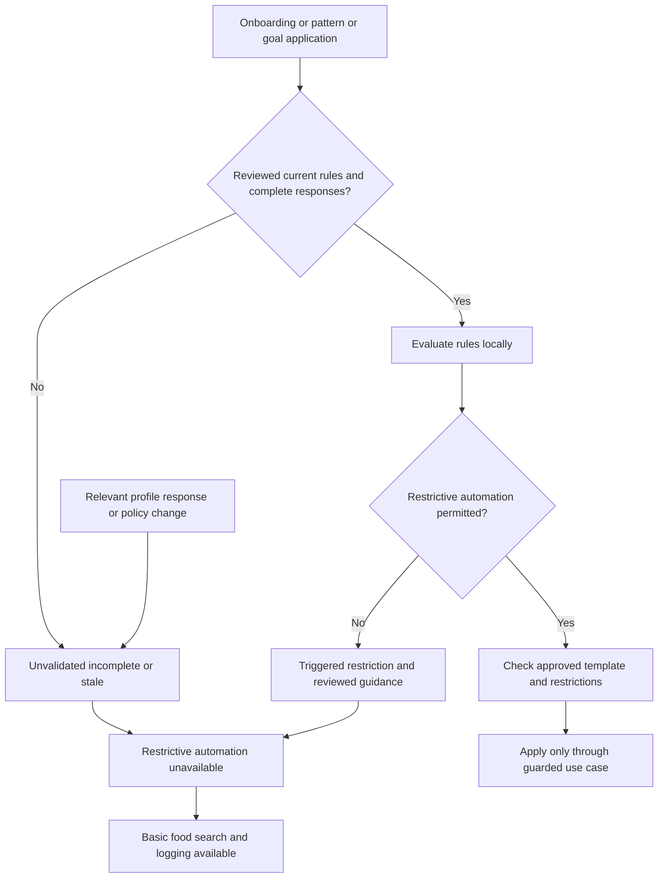

# DietMate BD — MVP UI/UX Specification

Phase 0.4 · Documentation specification · 2026-11-13

Authority: [SRS v1.0](SRS.md), [Architecture](ARCHITECTURE.md), [Data Model](DATA_MODEL.md), and [PRD Section 14](PRD.md#14-mvp-definition). This specifies future React Native/Expo behavior; app implementation has not started. Documentation checks are not runtime, native accessibility, clinical approval or security verification.

## 1. Design intent and scope

Make recording a meal, understanding a partial nutrition total and preparing a dated grocery estimate easy on a small phone. Use a calm deep-green action color, slate typography, cool neutral surfaces and left-aligned labels. Reserve visual emphasis for the next useful action, not decoration. A simple daily ledger and clearly labeled quantities carry the identity; avoid health scores, celebratory weight judgments, illustrations, gradients, floating dashboards and heavy animation.

The MVP serves one local profile without login, internet, telemetry, paid services or downloadable assets. It includes manual logging, reviewed daily plans, groceries/BDT estimates, recorded weight history, local reminders, screening and privacy controls. No barcode, AI, voice, recipe library, pantry, family switching, weekly/monthly planning, Ramadan mode, export, backup/restore, cloud, subscriptions or consultation booking screens. Activity and water are reminder types, not new tracking features.

Use native stack transitions, native time/date controls where verified accessible, platform back gestures and Android Back. System dialogs retain platform wording. Keep interaction available without hover, swipe or drag. Flat sections and dividers are preferred; cards group actionable meals/items rather than boxing every label. All implementation choices below are recommendations unless mandated by the SRS. Clinical rules and native platform evidence remain gated.

## 2. Design tokens and layout

Tokens are semantic TypeScript theme values, independent of components. Light is the initial supported theme. Dark values establish compatibility only: no MVP theme-switch screen or claim of tested dark mode. Opaque backgrounds avoid unpredictable contrast. Do not use semantic colors as nutrition or eligibility judgments.

| Semantic token | Light | Dark candidate | Use |
| --- | --- | --- | --- |
| primary / onPrimary | #166534 / #FFFFFF | #86EFAC / #142019 | Main action, selected control |
| secondary / onSecondary | #334155 / #FFFFFF | #CBD5E1 / #142019 | Secondary filled action when needed |
| canvas | #F8FAFC | #101820 | Screen background |
| surface | #FFFFFF | #1E293B | Inputs, grouped content, sheets |
| text | #0F172A | #F8FAFC | Main content |
| textMuted | #475569 | #CBD5E1 | Supporting labels and dates |
| borderControl | #64748B | #94A3B8 | Input/control outline and important dividers |
| divider | #E2E8F0 | #475569 | Decorative section boundary only |
| selectedSurface | #DCFCE7 | #163322 | Selected row background with primary/text label |
| success / successSurface | #166534 / #DCFCE7 | #86EFAC / #163322 | Successful committed save, icon plus text |
| warning / warningSurface | #854D0E / #FEF9C3 | #FDE047 / #392F12 | Partial/stale/unresolved state, icon plus explanation |
| error / errorSurface | #B91C1C / #FEE2E2 | #FCA5A5 / #3B1C23 | Field/storage failures and destructive action |
| focus | #1D4ED8 | #93C5FD | Visible focus outline |
| disabledSurface / disabledText | #E2E8F0 / #475569 | #334155 / #CBD5E1 | Disabled action with reason nearby |

Only declared foreground/background pairings are approved for use. Normal text needs contrast ≥4.5:1; large text ≥3:1; meaningful icons/control boundaries/focus indicators ≥3:1 against adjacent surfaces. Avoid opacity-based disabled labels; retain readable reasons even where disabled controls have contrast exemptions. Validate token pairings computationally and repeat with actual rendered typography; semantic fills are paired with their semantic foreground, never white text on pale fills. Divider is not an input boundary. Dark combinations require their own contrast/native review before enabling.

| Token group | Specification |
| --- | --- |
| Font | System sans-serif for English and verified platform Bangla fallback; no runtime font download. If glyph coverage fails, bundle a redistribution-verified free Bangla family such as Noto Sans Bengali after size/license review; test all shaping/weights before selecting. No paid font dependency. |
| Type size / initial line height | caption 12/18, label 14/22, body 16/24, section 20/30, screen title 24/34, numeric summary 32/42. Values are RN logical text sizes before OS scaling, not fixed container heights. Bangla may need increased line height after glyph tests; never clip marks. |
| Weight | Body regular; labels/buttons medium; headings semibold. Do not synthesize an unavailable Bangla weight; use the tested fallback. Tabular digits only if the selected font supports them. |
| Spacing | 4, 8, 12, 16, 24, 32 logical units; screen padding 16, sections 24, rows 12, related labels 8. At 320-unit width use 12 side padding where needed. |
| Radius | Input/button 8; grouped meal/card 12; sheet 16; pill only for brief status labels. |
| Elevation | Flat default with divider; raised overlay at most iOS shadow opacity 0.12/radius 8/offset 0,2 and Android elevation 2 as candidates. Test clipping/performance; overlays remain understandable without shadow. |
| Inputs | Visible persistent label, min-height 48, horizontal padding 12, 1-unit borderControl; error text and icon below. Multiline grows; unit is a separate label, not placeholder. |
| Buttons | Primary filled primary/onPrimary; secondary surface/primary with primary outline; tertiary text action with full target; destructive error/white in light theme (dark uses error/dark text). Min-height 48, padding 16; text wraps, height grows. |
| Icons | 20 inline, 24 actions/tabs; consistent local outline set, not emoji. Do not import a large remote icon/font asset for a few symbols. |
| Targets | All actionable targets at least 48×48 logical units on both platforms, with 8 separation where practical. Visual glyph may be smaller; hit areas cannot overlap. |
| Interaction | Pressed darkens/lightens paired fill without losing contrast; focus uses 2-unit focus outline with 2-unit gap. Disabled and saving states expose accessibility state and cannot submit twice. Loading retains action label, e.g. Saving entry. |
| Motion | No animated count-up, chart drawing or shimmering skeletons. Short platform transitions only; respect reduced-motion setting, remove optional translations/pulses; no timer-driven decoration. |

Single-column layout from 320 logical units; use flex/wrapping rather than fixed widths. Test 320, 360, 390 and 430 widths and landscape. At wider sizes center content at a proposed max width of 600; no tablet-only feature. Respect safe areas, system bars, keyboard and bottom tab inset. Scrollable content has enough bottom padding that final actions are visible. At 200% text, convert horizontal metric rows into vertical rows; labels wrap without ellipsizing safety content. Use a scrollable footer when a sticky button would obscure content. Tab labels may wrap to two lines and tab bar height grows; verify native feasibility before choosing custom chrome.

Home layout sketch (values intentionally omitted):

```text
Header: Today                         Settings
Date selector
Daily intake: recorded calories + completeness
Protein / Fat / Total carbs: labeled rows
Add food                              primary action
Meals logged: entries or empty action
Today's plan                          separate from intake
Latest recorded weight                View progress
Reminders                             Manage
Home | Food Log | Planner | Grocery | Progress
```

Intake and planned totals are always distinct. Progress bars appear only with an approved, available target; otherwise show recorded amount and “Target unavailable”. Never create a target, deficit, remaining allowance or macro percentage from a placeholder formula. Above-target values remain readable without moralizing red/green feedback.

## 3. Navigation contract and screen inventory

There are **30 screen definitions and 30 unique route patterns**, including bootstrap/recovery. IDs are UI-00 through UI-29. Reusable confirmation dialogs/sheets are not extra routes/screens. Expo Router filesystem examples use `apps/mobile/app`; group names do not appear in public URLs. Static `new`/`edit` paths must resolve before dynamic IDs; validate all path parameters and ownership in use cases.

Five tabs in order: Home, Food Log, Planner, Grocery, Progress. Settings is a header action, not a sixth tab. This is a presentation refinement of ARCHITECTURE Section 4's illustrative `(main)` tab list (which combined Plan/Groceries and included Settings); it preserves its onboarding, feature/use-case boundaries and safety gates. No source architecture file is changed. Route groups: `(onboarding)` and `(main)`; settings, editors and screening sit in the root stack above tabs so forms have an unambiguous Back action.

| ID | Route pattern | Suggested route file | Entry / parent |
| --- | --- | --- | --- |
| UI-00 | / | app/index.tsx | Cold start, restart, recovery redirect |
| UI-01 | /welcome | app/(onboarding)/welcome.tsx | UI-00 without profile |
| UI-02 | /setup/profile | app/(onboarding)/setup/profile.tsx | UI-01 Continue |
| UI-03 | /setup/preferences | app/(onboarding)/setup/preferences.tsx | UI-02 successful save |
| UI-04 | /screening | app/screening.tsx | UI-03, UI-05 unfinished screen, UI-14 apply, UI-25 relevant edits |
| UI-05 | /setup/complete | app/(onboarding)/setup/complete.tsx | UI-04 result or Continue with logging |
| UI-06 | /home | app/(main)/home.tsx | UI-00 ready, UI-05 Finish, Home tab |
| UI-07 | /log | app/(main)/log.tsx | Food Log tab, Home meal list |
| UI-08 | /foods/search | app/foods/search.tsx | UI-06/07 Add food; UI-15 Add/replace item |
| UI-09 | /foods/[foodId] | app/foods/[foodId].tsx | UI-08 result |
| UI-10 | /foods/[foodId]/portion | app/foods/[foodId]/portion.tsx | UI-09 Choose portion |
| UI-11 | /entries/[entryId] | app/entries/[entryId].tsx | UI-07 saved entry |
| UI-12 | /nutrition | app/nutrition.tsx | UI-06/07 intake total, UI-13 planned total |
| UI-13 | /planner | app/(main)/planner.tsx | Planner tab, UI-06 plan overview |
| UI-14 | /diet | app/diet.tsx | UI-13 pattern action, UI-24 Diet settings |
| UI-15 | /planner/meals/[mealId] | app/planner/meals/[mealId].tsx | UI-13 Add meal draft or existing meal |
| UI-16 | /grocery | app/(main)/grocery.tsx | Grocery tab, UI-13 Generate groceries |
| UI-17 | /grocery/items/[itemId] | app/grocery/items/[itemId].tsx | UI-16 item quantity/price details |
| UI-18 | /prices | app/prices.tsx | UI-17 Search or enter price |
| UI-19 | /grocery/regenerate | app/grocery/regenerate.tsx | UI-16 Regenerate after plan changes |
| UI-20 | /progress | app/(main)/progress.tsx | Progress tab, UI-06 weight summary |
| UI-21 | /weight/[entryId] | app/weight/[entryId].tsx | UI-20 Add weight (reserved new) or history row |
| UI-22 | /reminders | app/reminders.tsx | UI-06, UI-05 optional action, UI-24 |
| UI-23 | /reminders/[reminderId] | app/reminders/[reminderId].tsx | UI-22 type-specific Add (reserved new) or row |
| UI-24 | /settings | app/settings.tsx | Header Settings action on each tab |
| UI-25 | /profile/edit | app/profile/edit.tsx | UI-24 Profile |
| UI-26 | /settings/language | app/settings/language.tsx | UI-24 Language |
| UI-27 | /settings/privacy | app/settings/privacy.tsx | UI-24 Privacy; UI-01 privacy link |
| UI-28 | /settings/protection | app/settings/protection.tsx | UI-27 Data protection |
| UI-29 | /settings/delete | app/settings/delete.tsx | UI-27 Delete local data |

Route parameters/query values contain only validated IDs, context enums, dates and return-screen IDs; no health answers, measurements, consent payloads or serialized forms. Search context is `log` or `plan`; nutrition context is `intake` or `plan`, labeled prominently. New meal/weight/reminder editors use a reserved draft identifier `new` recognized by the router/use case; IDs generated for saved records must exclude that token. Drafts stay transient, not empty persisted rows.

Root guard resolves bootstrap/key/schema/deletion state before rendering protected screens. No-profile deep links redirect to onboarding; privacy/protection information remains readable before setup, with user-specific controls hidden until a profile exists. Saved profile with unfinished setup shows a resume banner but provides Food Log/Home; incomplete screening never locks the user out of basic logging. Completion is not medical clearance. Onboarding Back can edit prior steps; do not re-show welcome after Finish on normal Back. `replace` the setup stack on Finish. Never discard committed profile data simply by returning to Welcome.

Use parent-stack Back/iOS gesture/Android Back to return to the caller. At a tab root, platform Back follows the configured native navigation policy (Android returns Home before allowing exit); do not invent cross-platform gesture parity. Unsaved forms show Discard changes / Keep editing for all exit methods, including tab/gesture navigation; saved data is unchanged on Discard. Success returns to the invoking list/date and moves focus to the affected summary or row. External deep-link editor with no history goes to its parent tab, not an empty stack. Missing/deleted IDs show a safe error and Back to parent action.

Use native confirmation dialogs for deletion/discard and a small sheet for unit/meal selection only when it remains accessible. Full-screen editors handle profile, screening, quantity and prices; no stacked sheets or swipe-only actions. At large text a sheet may present full-screen. Recovery UI-00 traps only unsafe database operations and offers Retry and bundled help; it never prompts login, downloads, silent reset or a post-MVP restore feature. Read-only privacy/protection information remains available there through UI-27/28.

## 4. Shared screen behavior contract

Every screen below inherits these testable requirements, which are part of each screen's specification:

- **Loading:** show a labeled, non-shimmer LoadingState for local queries; stable header/Back remain. Forms expose busy state and suppress duplicate submit. Never replace committed data with optimistic success.
- **Empty:** show a useful EmptyState and a relevant action, never invented values, a fabricated target or an online fallback. Screen-specific exceptions follow below.
- **Error:** inline field errors for invalid input; local ErrorState with Retry for read failures; safe retained form draft for failed saves. No health values/keys in error details. Root key/schema/integrity failures route to UI-00. Failed writes retain previous committed state.
- **Offline:** every described action and bundled guidance works from fresh airplane-mode installation through restart, subject only to actual local dataset, storage and notification permissions. No connectivity banner blocks use; no network spinner or account gate. System notification settings may open device settings, not an external API.
- **Validation:** Zod/use cases validate independently of UI, including ownership, finite/positive quantities, approved enums and revision checks. The UI never recomputes eligibility, prices or nutrition with ad hoc formulas. Required fields have visible labels; Save remains discoverable with a stated reason when disabled.
- **Acceptance:** on Android/iOS in Bangla/English, actions are screen-reader reachable, at least 48-unit targets and usable at 200% text. Save succeeds only after local commit; cancel/failure leaves old saved state intact. Persisted records reload after restart. These are acceptance specifications, not executed tests.

### UI-00 — Bootstrap and recovery

**Route:** `/`. **Purpose:** select the safe next screen. **Layout/components:** wordmark text, LoadingState, then ErrorState/Retry and bundled help if needed; Privacy link. **Actions:** retry key/database open, read help/privacy; resume pending deletion cleanup. **Validation:** supported schema, protected key access, catalog manifest and recovery state; no destructive reset. **States:** first install provisions local storage offline; existing records restore; empty/missing catalog is a catalog error, not an onboarding/network error. Key loss/corruption/full disk retains files and stops unsafe writes. **Offline:** shared contract, migrations and help bundled. **SRS:** FR-015, FR-035, FR-036, FR-038, FR-039. **Acceptance:** routes new users to UI-01, existing users to UI-06 or pending safe recovery; never claims recovered data without verification.

### UI-01 — Welcome

**Route:** `/welcome`. **Purpose:** explain the local app and select language. **Layout/components:** app title, two short purpose lines, English/বাংলা choice, privacy link, PrimaryButton Continue. **Actions:** choose locale, read UI-27, continue. **Validation:** supported locale; no account, email or consent bundling. **States:** no records is normal; locale assets load locally; missing assets show bundled fallback text. **Offline:** no download/font request. **SRS:** FR-001, FR-016, FR-037. **Acceptance:** language changes labels immediately and Continue enters UI-02 without login or optional-sharing consent.

### UI-02 — Local profile setup

**Route:** `/setup/profile`. **Purpose:** collect required minimum profile measurements. **Layout/components:** step heading, age in years/as-of label, height cm, weight kg/lb input with explicit unit, activity SelectField, Continue, Back. **Actions:** enter values, select approved activity enum, save. **Validation:** required fields, finite positive measurements, valid age integer and approved engineering enums; clinical eligibility is separate, no invented cutoff. **States:** blank first-use form; failed save retains draft and prior saved values; reopened step loads committed data. **Offline:** profile saved locally only. **SRS:** FR-001, FR-018, FR-032, FR-035. **Acceptance:** invalid input names the field; valid commit opens UI-03; unsupported ranges/enums wait for D-003 rather than guessed options.

### UI-03 — Preferences and goals

**Route:** `/setup/preferences`. **Purpose:** collect goals, foods preferred, restrictions/allergies and desired pattern. **Layout/components:** labeled goal/preference controls, restrictions/allergy selectors using approved vocabulary, pattern choices, separate optional Calorie Deficit goal, SafetyNotice, Continue. **Actions:** edit selections, review screening. **Validation:** one Keto/Low-Carb/Balanced pattern; deficit is a goal, not a fourth pattern. Unknown/incomplete allergy metadata is explicit. **States:** no declared restrictions is explicit selection, not assumed from untouched fields; unsupported combination leaves saved config unchanged. **Offline:** all options and descriptions bundled. **SRS:** FR-004, FR-005, FR-018, FR-019, FR-026. **Acceptance:** captures draft preferences without activating a restrictive plan; UI-04 runs before application.

### UI-04 — Safety screening and result

**Route:** `/screening`. **Purpose:** ask reviewed local questions and enforce the result. **Layout/components:** purpose/privacy explanation, versioned questions, labeled response options, Review result button; result SafetyNotice with Continue with food logging and optional Back to edit responses. **Actions:** answer, submit, revisit incomplete answers, return to diet flow only when authorized. **Validation:** only professionally approved questions/rules; incomplete, stale, triggered or unvalidated eligibility cannot authorize restrictive automation. **States:** missing rules display planning unavailable, never fabricated questions; result wording does not diagnose or claim clearance. **Offline:** questions and professional-advice guidance bundled. **SRS:** FR-012, FR-013, FR-014, FR-019, FR-040. **Acceptance:** triggered/unresolved result blocks restrictive apply but always offers logging; policy/profile changes force re-evaluation at application.

### UI-05 — Onboarding completion

**Route:** `/setup/complete`. **Purpose:** confirm saved setup without medical assurances. **Layout/components:** saved-profile summary, screening status, primary Start food log/Home, optional Set reminders, Edit profile. **Actions:** Finish replaces setup stack with UI-06; reminders may be deferred. **Validation:** show saved values/status only; setup completion does not imply eligible automation. **States:** incomplete/blocked screening has visible guidance and logging access; failed setup save cannot show Saved. **Offline:** all next steps local. **SRS:** FR-001, FR-013, FR-015, FR-017. **Acceptance:** declining notifications or unresolved screening still permits Home/logging; restart retains committed setup.

### UI-06 — Home dashboard

**Route:** `/home`. **Purpose:** summarize the selected day's recorded intake and next actions. **Layout/components:** AppHeader/date, NutritionSummary, three MacroProgress rows, Add food, logged meal overview, separate plan summary, latest recorded weight/date, reminders link. **Actions:** change day, add food, open log/nutrition/plan/progress/reminders/settings. **Validation:** targets only from current approved policy; never add planned meals into consumed totals. **States:** empty day shows zero recorded intake, not missing-data zero; partial nutrients labeled per metric; no weight shows Add weight; invalidated plan shows unapplied status. **Offline:** reads committed snapshots. **SRS:** FR-003, FR-010, FR-015, FR-023, FR-024, FR-027, FR-033. **Acceptance:** refresh after save matches UI-07/12; unknowns and target-unavailable states remain distinct from zero and no records.

### UI-07 — Daily food history

**Route:** `/log`. **Purpose:** inspect and manage entries for one day. **Layout/components:** header/date selector, daily totals, meal-grouped FoodCards with time/portion/preparation, Add food, Nutrition details. **Actions:** change date, open UI-11, add via UI-08. **Validation:** local-date policy preserved; selecting another date does not rewrite timestamps. **States:** no entries offers Add food; partial totals disclose unknown entry count per nutrient; failed load is not an empty day. **Offline:** snapshots remain available after catalog changes. **SRS:** FR-003, FR-020, FR-021, FR-024, FR-025. **Acceptance:** chronological entries and totals restore after restart and reflect confirmed edits/deletes without stale rows.

### UI-08 — Food search

**Route:** `/foods/search`. **Purpose:** search verified bundled foods for logging or plan editing. **Layout/components:** SearchInput, context label, preparation labels, paginated FoodCards, source/verification status. **Actions:** type Bangla/English, clear search, select result, Back. **Validation:** bounded query; use verified IDs; no automatic raw/cooked substitution. For plan context filter/check restrictions and exclude unknown ingredient metadata from automatic selection. **States:** initial browse prompt; no match invites another name; empty catalog explains local data unavailable with Retry/help and no AI/cloud button; unverified records cannot be numeric inputs. **Offline:** local indexed queries only. **SRS:** FR-002, FR-022, FR-026, FR-041. **Acceptance:** query survives detail Back during session; correct preparation/source is visible; no match never fabricates nutrients.

### UI-09 — Food details

**Route:** `/foods/[foodId]`. **Purpose:** inspect verified basis before portion choice. **Layout/components:** bilingual food name, preparation, per-basis nutrient rows, total/net convention, source/version and composition limitations, Choose portion. **Actions:** open source information inline, choose portion. **Validation:** exact catalog record/release; unknown nutrients labeled unavailable; incompatible net operands yield unavailable. **States:** missing/withdrawn ID shows unavailable and Back to search; no authoritative calculation from unverified records. **Offline:** citations are bundled text, not required links. **SRS:** FR-020, FR-021, FR-022, FR-023, FR-024, FR-041. **Acceptance:** no unknown value displays as 0; net carbohydrate is optional labeled information, total remains default.

### UI-10 — Portion and save

**Route:** `/foods/[foodId]/portion`. **Purpose:** create a log entry or return an item draft to plan editing. **Layout/components:** food/preparation header, numeric TextField, grams or verified serving SelectField, calculated NutritionSummary, meal/date/time for log context, Save entry/Add to meal. **Actions:** change amount/unit, preview, confirm save. **Validation:** positive finite amount; named serving requires verified gram mapping; no guessed spoon, density or cooking yield. **States:** unmapped serving is unavailable with reason; unknown nutrients stay partial; storage failure retains entered amount. **Offline:** local engine and save only. **SRS:** FR-003, FR-020, FR-021, FR-024, FR-026, FR-035. **Acceptance:** display rounds half-up to two decimals while saving exact snapshots; successful log returns UI-07/date; plan context changes only UI-15 draft until Save meal.

### UI-11 — Edit/delete food entry

**Route:** `/entries/[entryId]`. **Purpose:** correct a saved log entry. **Layout/components:** original snapshot/source/version/preparation, portion/date/time fields, recalculated preview, Save changes, secondary Delete entry. **Actions:** edit; confirmed Delete/Cancel dialog. **Validation:** same portion rules; an unavailable old mapping needs explicit verified replacement, never silent remapping; stale revision returns review/reload choice. **States:** missing record returns parent; failed write retains prior entry; catalog change does not alter untouched history. **Offline:** original snapshots remain readable. **SRS:** FR-020, FR-021, FR-025, FR-035. **Acceptance:** cancel deletion preserves entry; confirmed successful delete recalculates affected day; cross-day edits update both day summaries.

### UI-12 — Nutrition breakdown

**Route:** `/nutrition`. **Purpose:** explain totals and missing values. **Layout/components:** date and Intake/Planned heading, nutrient rows with amount/unit, completeness and missing-entry count; per-entry contributions, total/net convention, source detail disclosure. **Actions:** inspect contributing item via its parent context, Back. **Validation:** exact snapshot aggregation; no fiber subtraction from mismatched partial totals. **States:** no entries is zero recorded; all unknown is unavailable; partial is Known subtotal—not complete total; approved target absent means no progress percentage. **Offline:** no nutrition lookup required. **SRS:** FR-003, FR-021, FR-023, FR-024, FR-027. **Acceptance:** daily displayed total is rounded once from unrounded contributions; displayed rounded rows need not sum exactly and the rounding note explains this.

### UI-13 — Daily meal planner

**Route:** `/planner`. **Purpose:** create and edit one selected day's plan. **Layout/components:** date, pattern/goal and screening status, MealCards, Add meal, planned NutritionSummary, Generate groceries. **Actions:** UI-14 pattern, UI-15 add/edit/remove meal, apply eligible reviewed template, UI-16 groceries. **Validation:** screen before every pattern/goal apply; current profile/rule revisions and restrictions/allergies checked on save/apply. **States:** no eligible template explains unavailable with logging CTA; changed eligibility keeps prior plan visibly unapplied; unknown allergen metadata blocks automatic selection. **Offline:** bundled reviewed templates only. **SRS:** FR-004, FR-005, FR-006, FR-012, FR-013, FR-026, FR-027. **Acceptance:** all meal/portion edits reload exactly; restrictive automation stays blocked without approved eligibility; plan edits visibly mark groceries stale.

### UI-14 — Diet pattern and energy goal

**Route:** `/diet`. **Purpose:** choose supported configuration without implying treatment. **Layout/components:** three single-select pattern rows with reviewed descriptions, separate deficit switch/choice, current eligibility, Apply selection. **Actions:** stage choice, open UI-04 then apply through normal use case, cancel. **Validation:** no unapproved target numbers or invented macro ratios; unsupported combination cannot overwrite active config. **States:** unreviewed policy shows unavailable; screening triggered gives Continue logging action; applying failure retains prior valid state subject to existing invalidation. **Offline:** reviewed explanations/rules bundled. **SRS:** FR-004, FR-005, FR-012, FR-019, FR-040. **Acceptance:** switching goal never creates a fourth pattern; re-evaluation cannot be bypassed by Back, deep link or stale screen.

### UI-15 — Meal editor

**Route:** `/planner/meals/[mealId]`. **Purpose:** add/replace/remove meal contents and adjust portions. **Layout/components:** meal label/order control, item rows with preparation/grams, Add/replace food, item quantity fields, planned totals, Save meal, Remove meal dialog for saved meal. **Actions:** use UI-08/09/10 in plan context; change portion, remove item/meal, save/cancel. **Validation:** positive finite portions and verified mappings; known allergy conflicts block save/application; unknown metadata explains limitation and prevents automatic selection. No drag-only reordering. **States:** empty draft prompts Add food; rejected replacement retains previous saved meal; failed save retains draft. **Offline:** no recipe catalog or AI. **SRS:** FR-006, FR-020, FR-026, FR-027, FR-035. **Acceptance:** edits affect plan only, never log intake; successful save updates plan revision/totals and stale-grocery state atomically.

### UI-16 — Grocery list and estimate

**Route:** `/grocery`. **Purpose:** prepare shopping from the selected daily plan. **Layout/components:** date/source plan status, BudgetSummary, unresolved/needs-price group, To buy and Purchased groups, GroceryItems, Generate/Regenerate action. **Actions:** initial generation, quantity/price detail, toggle purchased, review UI-19 after plan change. **Validation:** combine same ingredient/preparation key and compatible units only; unresolved items never dropped; purchased items remain in full-plan estimate. **States:** no plan links UI-13; no list offers Generate; stale list has visible plan-version warning; partial/all-unknown prices have distinct subtotal/no-known-prices states. **Offline:** dated bundled/user prices only. **SRS:** FR-007, FR-008, FR-009, FR-028, FR-029, FR-031. **Acceptance:** initial generation is saved atomically; group counts match visible lines; plan changes never silently overwrite overrides.

### UI-17 — Grocery quantity and item details

**Route:** `/grocery/items/[itemId]`. **Purpose:** inspect generated quantity and record a local override. **Layout/components:** ingredient/preparation, generated amount/unit, editable override, purchased checkbox, mapping limitation, current dated price, Save changes, Reset to generated quantity. **Actions:** override, reset explicitly, mark purchased, UI-18 price search. **Validation:** compatible normalized unit, finite nonnegative override (explicit zero permitted), positive generated quantity; no mass/volume/count conversion without verified mapping. **States:** unknown conversion shows original unresolved quantity separately; failed save does not lose old override/status. **Offline:** all editing local. **SRS:** FR-028, FR-029, FR-030, FR-031. **Acceptance:** zero override is explicit and differs from unknown; quantity/status commit together and full-plan estimate updates from committed values.

### UI-18 — Local price search and entry

**Route:** `/prices`. **Purpose:** find dated local prices or save user-provided BDT price. **Layout/components:** ingredient identity, local price results with origin/date/geography/unit, entry form amount/basis quantity/unit/date, Save price. **Actions:** choose compatible result, enter/correct local price. **Validation:** BDT only; finite amount ≥0, basis >0, compatible unit and valid date; historical selection follows architecture date policy. **States:** no price offers entry; unavailable conversion remains unpriced; stale-age threshold pending D-004 means show exact date/age and estimate limitation, not “live” or “fresh”. **Offline:** manual local search, no market API. **SRS:** FR-008, FR-009, FR-030, FR-031. **Acceptance:** explicit zero is saved; invalid price leaves prior values; new price triggers explicit current-list recalculation while older estimate snapshots remain reproducible.

### UI-19 — Regeneration review

**Route:** `/grocery/regenerate`. **Purpose:** preview plan-derived changes and resolve overrides before replacement. **Layout/components:** source plan revision, additions/removals/changed quantities, retained purchased status, affected override warnings with Keep/Reset decisions, Apply changes and Cancel. **Actions:** resolve every affected/removed edited line, keep compatible surviving status/overrides, apply or cancel. **Validation:** require decisions before Apply, recheck plan/list revisions at commit; removed overridden item cannot silently persist under unrelated ingredient. **States:** no differences says Up to date; concurrent edit offers Rebuild preview; failed commit preserves whole old list. **Offline:** diff from local snapshots. **SRS:** FR-007, FR-029, FR-035. **Acceptance:** cancel is byte-equivalent saved-list preservation; successful replacement is complete, with flagged kept overrides visible and no half-updated estimate.

### UI-20 — Progress and weight history

**Route:** `/progress`. **Purpose:** show recorded weight chronology, not predict outcomes. **Layout/components:** latest weight with timestamp, WeightChart, equivalent textual history, Add weight, history rows. **Actions:** add/edit/delete via UI-21; select a bounded history range for viewing. **Validation:** chronological timestamp/ID order; kg canonical, kg/lb display; no goal forecast, ideal-weight claim or health score. **States:** zero entries shows Add weight; one shows one point without inferred trend; two or more recorded points can connect without prediction/smoothing. **Offline:** local history. **SRS:** FR-010, FR-032, FR-033. **Acceptance:** chart and text contain identical records; “Latest recorded weight” is not labeled a current clinical assessment; out-of-order entries render correctly.

### UI-21 — Weight entry editor

**Route:** `/weight/[entryId]`. **Purpose:** add or correct a dated weight. **Layout/components:** numeric weight/unit, timestamp picker plus accessible text alternative, optional explicit Update profile weight action, Save, confirmed Delete for existing entry. **Actions:** kg/lb input, edit date/time, save/delete/cancel. **Validation:** finite positive value, valid timestamp, exact source conversion; no invented medical range; profile update invalidates eligibility as specified. **States:** new blank form, missing ID parent fallback, invalid timestamp field error, disk-full retained draft. **Offline:** local commit only. **SRS:** FR-018, FR-019, FR-032, FR-035. **Acceptance:** two-decimal display never overwrites full precision on untouched edit; deletion cancel retains record; explicit profile update is atomic with weight mutation.

### UI-22 — Reminder list and permissions

**Route:** `/reminders`. **Purpose:** manage desired local schedules and actual permission/scheduling status. **Layout/components:** OS permission banner, Meal/Water/Activity sections, ReminderCards with wall time/timezone/enabled and status, Add controls. **Actions:** create/edit reminder, enable/disable, request permission when enabling, open system settings after denial where platform supports it. **Validation:** no permission request on mere view; preferences and scheduling outcome separate. **States:** no schedules invites Add; denied/revoked permission retains preferences and logs remain usable; failure is Not scheduled, not Delivered. **Offline:** local OS scheduler only. **SRS:** FR-011, FR-017, FR-034. **Acceptance:** all three types accessible without new tracking screens; turning off cancels superseded requests and displays any incomplete cancellation.

### UI-23 — Reminder editor

**Route:** `/reminders/[reminderId]`. **Purpose:** configure one desired reminder. **Layout/components:** type SelectField, time picker, timezone label, approved recurrence controls, enabled switch, Save reminder, Disable for existing reminder. **Actions:** save, change time/recurrence, disable; permission prompt only in enabling context. **Validation:** valid wall time/timezone/approved recurrence; DST/timezone policy D-006 unresolved means no invented guarantee. **States:** scheduling-pending state after desired-state commit; rejected OS operation retains desired preference with retry guidance; denied state does not claim scheduled. **Offline:** OS requests reconciled after edits/restart/timezone changes. **SRS:** FR-011, FR-017, FR-034, FR-035. **Acceptance:** one current request per approved occurrence/recurring schedule, no duplicate on crash retry; delivery may be delayed or suppressed by OS.

### UI-24 — Settings hub

**Route:** `/settings`. **Purpose:** expose secondary controls without a sixth tab. **Layout/components:** rows Profile, Language, Diet settings, Reminders, Privacy and data, bundled Medical information disclosure. **Actions:** open UI-25/26/14/22/27; read medical limitations inline. **Validation:** no account, subscription, sync, export, theme or future-feature menu items. **States:** preference read failure shows Retry; absent optional consent never blocks settings/core use. **Offline:** all information bundled. **SRS:** FR-016, FR-018, FR-019, FR-034, FR-037, FR-040. **Acceptance:** every row has unique accessible name; medical text has no diagnosis, treatment promise or live consultation requirement.

### UI-25 — Edit local profile

**Route:** `/profile/edit`. **Purpose:** update the same single profile. **Layout/components:** reusable UI-02/03 form sections, saved values, explanation that relevant edits require re-screening, Save changes. **Actions:** edit demographics/measurements/goals/preferences/restrictions/allergies; save/cancel. **Validation:** same required fields/enums; no second profile; relevant changes invalidate eligibility/applied plan without deleting logs. **States:** invalid save retains old values; successful invalidation provides Review screening and Continue logging. **Offline:** no remote profile/account. **SRS:** FR-001, FR-018, FR-019, FR-026, FR-040. **Acceptance:** all required profile fields editable; confirmed valid changes persist and stale safety state cannot activate a plan.

### UI-26 — Language preference

**Route:** `/settings/language`. **Purpose:** choose English or Bangla. **Layout/components:** two radio rows labeled English and বাংলা, sample line, Save language. **Actions:** select/save/cancel. **Validation:** supported locale only; neither choice changes units, saved values or layout direction. **States:** current choice selected; failed save retains prior persisted preference; preview can be reverted on cancel. **Offline:** translations bundled, LTR in both languages. **SRS:** FR-015, FR-016. **Acceptance:** switching updates safety/error/accessibility text without losing active form drafts or relabeling stored enum codes.

### UI-27 — Privacy, consent and medical information

**Route:** `/settings/privacy`. **Purpose:** explain local data purposes and optional-sharing choices. **Layout/components:** plain-language data categories/purposes, optional-purpose controls/status, medical limitations, Data protection link UI-28, Delete local data UI-29 for existing profile. **Actions:** read, decline/withdraw any applicable optional consent; accept only a supported reviewed purpose with its notice. **Validation:** default off; no blanket consent tied to core use; no collection/transmission begins in MVP. Unavailable future services display informational Off—not available, not an activating toggle. **States:** first use has no consent record; failed choice save leaves old state and explicit error; pre-profile view hides personal controls. **Offline:** locally readable purpose notices. **SRS:** FR-014, FR-037, FR-039, FR-040. **Acceptance:** declining/withdrawing retains all core flows; no screening answer is presented in a privacy analytics summary; medical wording requires professional/translation review.

### UI-28 — Data protection information

**Route:** `/settings/protection`. **Purpose:** explain storage controls and limits truthfully. **Layout/components:** local storage explanation, data categories, platform limitations, key-loss/recovery limitations, bundled help; no green shield badge or encryption toggle. **Actions:** read and Back; available before profile and during recovery. **Validation:** current design/prototype copy says “Encryption is required before release; implementation verification is pending.” Production copy may claim verified at-rest encryption only after D-005 evidence, never E2EE or compromised-device protection. **States:** key-unavailable guidance does not promise recovery; no Restore backup action in MVP. **Offline:** bundled text only. **SRS:** FR-036, FR-038, FR-039. **Acceptance:** copy distinguishes local encryption target from implemented protection and future portable backups; sensitive keys/paths are never displayed.

### UI-29 — Delete local data

**Route:** `/settings/delete`. **Purpose:** allow confirmed deletion without account/internet. **Layout/components:** explicit scope (profile, screening, consent, logs, plans, groceries, local prices, weights, schedules), exported-copy/forensic limits, Cancel and Delete local data; final ConfirmationDialog. **Actions:** confirm or cancel, retry incomplete cleanup. **Validation:** destructive confirmation required; disable repeat action while cleanup runs; no typed phrase, login or online dependency. **States:** deleting is a durable multi-step cleanup, not success; cancellation failures route to pending recovery UI-00 with Retry; no false success if storage/OS cleanup fails. **Offline:** database/key/notification cleanup local. **SRS:** FR-035, FR-036, FR-039. **Acceptance:** cancel changes nothing; fresh Welcome appears only after verified personal-data and schedule cleanup; interrupted deletion resumes rather than recreating reminders.

## 5. Localization contract

Use keys `feature.screen.element.state`, e.g. `food.portion.amount.label`, `grocery.budget.partial`, `safety.result.loggingAction`; stable enum codes never become translation keys assembled from user input. Bundle matching `en` and `bn` dictionaries and validated interpolation placeholders. No concatenated sentences; plural/count/date interpolation must be locale aware and tested. Accessible labels, permission explanations, errors and bundled help belong in both dictionaries. Development missing keys fail validation; runtime uses bundled English fallback plus an internal non-sensitive key diagnostic, never raw keys or downloaded translation. Missing Bangla safety copy blocks release rather than treating fallback as completed localization.

Recommended MVP numeral decision: ASCII digits in editable numeric fields in both locales for predictable entry; accept Bangla ০–৯ and ASCII 0–9, normalize before validation, and label units visibly. Initially display ASCII digits consistently in both locales with translated labels; Bangla numeral output is a product/usability decision requiring approval before implementation. Decimal separator is `.` in entry help; reject ambiguous grouping input rather than guessing. Do not assume the keyboard emits a particular script/separator; support paste and correction accessibly.

BDT displays symbol ৳ plus two decimals and explicit BDT in accessible speech where the platform voice mispronounces the symbol. Use locale-aware grouping when verified; deterministic fallback is `BDT ` plus an ungrouped two-decimal amount. No exchange-rate conversion. Grammar includes “Estimated”, “Known subtotal” or “No known prices” as appropriate. Unit prices retain basis (per kg, per piece), date, geography and origin; zero price is explicit. Round line costs half-up to two decimals and sum those displayed line costs; nutrition totals instead round the sum of exact contributions once. Formatting is never a source of stored arithmetic.

Canonical cm/kg/g/ml are stored by the domain; display localized unit labels and permit kg/lb for weight only under FR-032. Named servings only from verified mappings. Show preparation next to the food name in both locales. Proposed terminology glossary for translation review: Food log → খাবারের হিসাব; Meal plan → খাবারের পরিকল্পনা; Grocery list → বাজারের তালিকা; Estimated cost → আনুমানিক খরচ; Total carbohydrate → মোট শর্করা. These are draft UI translations, not reviewed clinical guidance. Retain Keto/Low-Carb/Balanced names consistently with reviewer-approved Bangla explanations; Calorie Deficit stays a separate energy goal.

Use local-language month names where verified; prefer unambiguous day + written month + year in history/price detail. Show time with device 12/24-hour preference when supported, with a labeled fallback; persist UTC/timezone/local-date semantics from architecture. Show timezone where schedule/date ambiguity matters. No history regrouping on language/timezone change. Bangla is always **LEFT-TO-RIGHT (LTR)**: do not set RTL based on script or mirror tab order/icons. Font selection must test conjuncts, vowel marks, mixed Latin/BDT/unit strings, wrapping and screen-reader voice behavior on real Android/iOS; no unsupported platform fallback guarantee.

## 6. Accessibility and native interaction

Use RN accessibility roles/states: buttons have action names, radio/select controls announce choice and selected state, purchased checkboxes announce checked state, and busy/disabled controls expose status. Example button name: “Add food to breakfast”; entry row: food name, preparation, portion, timestamp, then an Edit action. Decorative icons are hidden from accessibility; icons with actions receive the full target and label. Never group an entire card as one accessible element if it hides separately actionable children. Read order follows visual hierarchy, not absolute-position order.

On submit, focus first invalid field and announce its label/error; error summary links focus to each field. Associate helper/error text through supported native accessibility APIs and test actual announcements rather than assuming web ARIA parity. Update one concise live announcement after a committed save; do not announce every keystroke or chart redraw. Dialogs/sheets isolate accessibility focus, announce title and restore caller focus; Android Back and iOS dismiss obey unsaved/destructive rules. Device permissions are OS UI; app explains purpose before request and returns focus afterward.

All screens allow text scaling through 200% without hidden primary actions, clipped Bangla glyphs or horizontal scrolling. Use scalable line heights, flexible cards and growable buttons. Selection, errors, safety blocks and partial values have icon/text labels, not color alone. Standard text ≥4.5:1; large text and essential graphics ≥3:1. Focus must be visible and not obscured by keyboard/footer; use keyboard avoidance and scroll-to-field behavior verified on both platforms. Hardware keyboard Tab/Shift-Tab reaches controls in meaningful order where supported; Enter/Space activate appropriate controls, Escape/Back dismisses safe overlays. No keyboard-only shortcut is required to complete a flow.

WeightChart always has an equivalent timestamp/value list reachable without chart gestures; summarize record count/date range, never infer trends from one point or predict weight. MacroProgress announces recorded amount, unit, completeness and approved target only if present; no unlabeled rings. Search results expose count/status once settled; return focus preserves search query/position. Reduced motion disables optional motion without removing feedback. Screens must work with VoiceOver, TalkBack, large text, switch/keyboard access where supported and reduced motion; no platform result is asserted yet.

## 7. Offline, failure, safety and privacy language

| Condition | User feedback and recovery | Forbidden behavior |
| --- | --- | --- |
| Fresh airplane-mode install | Welcome/setup and local dataset immediately available; brief “Your records stay on this device” explanation qualified by privacy limits | Login, download, connectivity prerequisite |
| Empty/unavailable catalog | “Food data is unavailable on this device.” Retry/help; retain access to existing saved snapshots | Invented food, AI search, treating failure as no results |
| Missing nutrient | “Unavailable” per field; “Known subtotal — incomplete” plus count for summaries | Unknown as zero or a complete macro ring |
| Invalid portion/mapping | Name invalid amount/unit and explain verified mapping needed; keep form | Inferred spoon size or raw/cooked yield |
| Missing price | Item Needs price; known subtotal and unpriced count; all absent → No known prices | Unknown as free/zero or complete total |
| Old price or stale groceries | Show exact price date/age and estimate limitation; stale list separately states plan changed and offers preview | Live-price claim or silently replacing overrides |
| Denied notifications | “Permission is off. Your reminder preference is saved.” Enable in system settings when supported | Repeated automatic prompts or blocking other features |
| Failed DB save / full storage | “Changes were not saved.” Keep draft, Retry; storage-specific guidance to free space using device controls | Success toast, deleting older records automatically |
| Restart | Reopen committed state; transient unsaved drafts are not promised restored; reconcile schedules | Silent reset or duplicating reminders |
| Migration/key/corruption error | Stop unsafe writes, preserve files, Retry/bundled help; warn key loss may be unrecoverable | Guaranteed recovery, key display, MVP backup restore button |
| Restricted/unresolved eligibility | “Automated restrictive planning is unavailable based on this screening. You can still log food.” Show professionally reviewed guidance | Diagnosis, medical clearance, threshold invention or paid consultation gate |

All copy above is functional draft wording; professional review must approve clinical questions, eligibility explanations and guidance in both languages. A non-alarming SafetyNotice explains why an action is unavailable and offers food logging rather than a danger-themed full-screen lockout. Never say “safe for you”, prescribe treatment or promise a weight result. No placeholder question or cutoff ships as a clinical rule. Manually edited plans still enforce the existing restrictions and cannot bypass the application safety gate.

Explain optional data sharing purpose-by-purpose with off defaults and separate notices; core use does not require sharing. Do not display functioning cloud/AI consent switches for unavailable features. Where local consent controls are required, record declines/withdrawals locally and clearly explain no MVP transmission occurs. Privacy notices describe health-data categories, retention until deletion and unlocked/compromised-device limits. Profile and screening content must not appear in route URLs, notifications, debug payloads or deletion progress identifiers. Notifications are generic by default.

Deletion is destructive and explicit but not intentionally hard: two steps (explanation then confirmation), plain scope, equally reachable Cancel, progress and retry. Do not promise forensic erasure or deletion of separately exported/OS-backed-up copies. Local AES-256 encryption remains the ARCHITECTURE D-005 release gate, **not implemented functionality**; no reassuring operational badge until Android/iOS/native/key/migration/performance verification exists. Portable encrypted backups/restore and readable export remain outside MVP under D-007.

## 8. Reusable component inventory

**21 named components**; native text/scroll/switch/list primitives and feature-specific editor composition are not a second design system. Components receive display models and callbacks; no SQL, eligibility rules or provider access inside shared components. Containers call application use cases; domain outputs drive amounts/status. All components inherit token, scaling, focus, busy/error and localization contracts above.

| Component | Responsibility / variants | Required states and behavior |
| --- | --- | --- |
| AppHeader | Title, optional Back/date/Settings; tab-root or stack variant | Long title wraps; accessible action names; safe-area/focus; no health data in chrome badges |
| BottomTabBar | Five labeled primary areas, preferably existing Router tab primitives | Selected state, text+icon; label growth; safe inset; no unread-health-score badge |
| PrimaryButton | Main committed action | Default, pressed, focus, disabled-with-reason, saving; no double submit |
| SecondaryButton | Outline, tertiary, destructive action variants | Same target/scaling as primary; destructive label explicit, confirmation owned by caller |
| TextField | Labeled text/decimal/date fallback input with optional unit | Empty, editing, valid, error, read-only, disabled; selection/paste and keyboard access |
| SelectField | Approved enum/unit selection via native accessible control or full-screen/sheet fallback | Selected, unset, unavailable choice with explanation, error; no invented options |
| SearchInput | Bilingual local query, clear action | Idle, typing, local loading, results, no match, query error; clear has label |
| FoodCard | Name, preparation, portion/basis, verification/source summary | Search result, saved-entry variant; unknown values explicit; separate edit action when needed |
| NutritionSummary | Energy and nutrients from domain view model | Intake versus planned, complete/partial/empty/unavailable/target-unavailable; source detail link |
| MacroProgress | One named macro with amount/unit and optional approved target | Text-only when target absent; partial label; unclipped over-target amount, no moral color coding |
| MealCard | Meal label, planned or consumed items, portions, edit action | Empty, saved, draft, unapplied, conflict; distinct planned/consumed language |
| GroceryItem | Ingredient, compatible quantity, purchased control, dated price/line cost | Generated, override/needs review, purchased, unresolved conversion, unpriced; separate controls |
| BudgetSummary | Full-plan estimate and coverage | Complete estimate, known partial subtotal, no-known-prices, stale-plan state; purchased included |
| WeightChart | Bounded recorded points and text alternative | Zero/one/many, read error, unit switch display; no predictions or heavy animated charting |
| ReminderCard | Type, wall time/timezone, enabled and actual scheduler status | Enabled, disabled, permission denied, pending, failed; never delivery confirmation |
| EmptyState | Short explanation and contextual local action | No records, no results, unavailable action; distinguish empty from read failure |
| ErrorState | Safe localized reason and Retry/Back/help | Inline, section, bootstrap-blocking; no raw exception or sensitive payload |
| LoadingState | Labeled local operation progress | Query/loading and saving labels; no endless network spinner, no shimmer |
| ConfirmationDialog | Explicit consequence with Cancel and confirm | Delete/discard/reset; focus containment/return; system Back cancels safely |
| SafetyNotice | Reviewed restrictions/guidance and available next action | Triggered, incomplete, stale, unvalidated, general limitation; not diagnosis or clearance |
| StatusNotice | Nonclinical completeness/price/scheduling/storage information | Info, warning, error with text+icon; bounded announcements; no color-only status |

## 9. Visual flows

### Onboarding



### Food logging



### Daily plan to groceries



### Screening and safety



## 10. Implementation readiness and QA

Suggested organization (proposal only; create no files/directories yet):

```text
apps/mobile/app/                     route groups and thin screen entry files
apps/mobile/features/               profile, screening, log, planner, grocery, weight, settings
apps/mobile/components/ui/          tokens and 21 reusable components
apps/mobile/application/            commands, queries and display-model mapping
apps/mobile/locales/                 en, bn, glossary and validation messages
apps/mobile/adapters/                notifications, lifecycle and protected storage
packages/domain/                    existing pure calculation/safety design
packages/database/                  repositories, schema, migrations and snapshot codecs
packages/food-data/                  verified bilingual bundle and reviewed policies
packages/shared/                    validated contracts and identifiers
```

Dependency order: tokens/type/layout → buttons/fields/status/loading/error/dialog → header/navigation → FoodCard/NutritionSummary/MacroProgress → profile/screening/log slice → meal/grocery/budget → weight/reminders/privacy cleanup. Shared components never import feature screens; route containers inject use cases; Zustand holds transient drafts/filters only, SQLite owns durable state. Keep date/number formatting in UI adapters and calculations in the domain. No UI component imports Drizzle directly.

Implement the small vertical slice **Welcome/profile/preferences/screening → Home → Food Search → portion/log save → Daily Summary**, including blocked-screening logging access, unknown nutrients, two locales and restart. Start with reviewable static view models, then connect SQLite and the deterministic engine before adding the rest of the planner. This is an incremental implementation order, not permission to skip other MVP acceptance gates.

| Priority / screens | Static-first scope | Required real integration before acceptance |
| --- | --- | --- |
| P0 UI-00–12, UI-25/26 | Forms, typography, summary complete/partial/empty/error, reviewed-rule outcome fixtures | Encrypted bootstrap/key gate, local profile/screening/catalog, exact engine, log transactions/snapshots, locale persistence and airplane-mode restart |
| P1 UI-13–19 | Meal editing, restriction notices, list/price/regeneration view models | Approved template/rule versions, ingredient mappings, plan/list revisions, atomic replacement, price dates and exact line costs |
| P1 UI-20/21 | Empty/one/multiple chart points and accessible history using synthetic fixtures | SQLite chronology, exact kg/lb conversion, confirmed mutations and optional profile-update invalidation |
| P1 UI-22/23 | Permission/scheduler status fixtures | Real OS permissions/recurring requests, denial/revocation/restart/timezone and duplicate/cancellation failure tests on each platform |
| P0 privacy UI-24/27–29 | Purpose notices, pending-security text, deletion confirmation/failure layouts | Local consent persistence, D-005 evidence, durable data/key/OS deletion cleanup, no false success |

Synthetic fixture numbers are arithmetic/UI test inputs only; use SRS N1/N2/G1 for expected arithmetic and approved clinical rule fixtures. Do not ship mock nutrition facts or invented screening questions. Static screens must label fixture-only prototype content; production data paths reject unverified records.

Acceptance checklist for implementation:

- Execute all ten core feature paths from fresh airplane-mode install through restart in both languages/platforms; no required network request, login, download, telemetry or paid provider.
- Review all UI-00–29 entries and each listed parent entry; tab/header/Back/deep-link access reaches every screen; stale/missing IDs safely return to parent. No raw health data in routes.
- Verify SRS FR-001–041 and AT-001–046 with actual evidence; document-only completion does not pass any runtime test. SYS/NFR measurements and all three PRD milestones remain mandatory.
- Verify complete/partial/unknown/zero nutrition, total/net convention, raw/cooked identity, serving failures, snapshot stability after catalog upgrades, and exact rounding. Planned values never count as consumed.
- Exercise allergy conflict, unknown metadata, triggered/incomplete/unvalidated/stale screening, no eligible template and current policy re-evaluation; logging remains usable.
- Test missing/all-missing/zero/old prices, unresolved dimensions, purchased full-plan totals, explicit overrides, regeneration keep/reset/removal/cancel and revision conflicts.
- Test valid/invalid weight/time, kg/lb, zero/one/many recorded points with textual equivalents; no forecasts or claims of outcomes.
- Verify all components at 320-unit width and 200% text, LTR Bangla glyph shaping/long labels, VoiceOver/TalkBack focus and names, contrast pairings, error announcements, modal focus return, keyboard/safe-area visibility and reduced motion.
- Deny/revoke notifications and inject schedule/cancel failure, restart/timezone changes and app-closed recurrence; desired state remains truthful, duplicate requests absent, no delivery guarantee.
- Inject key/migration/corruption/storage/save/deletion failures. Preserve committed data, retain safe drafts for retry, no silent reset, no false success. Verify privacy notices and actual implementation/security evidence agree.

## 11. Open decisions and documentation validation

| Open decision | Owner / next action | Consequence until resolved |
| --- | --- | --- |
| D-001 clinical questions, rules, templates, targets and bilingual guidance | Qualified clinical reviewers approve versioned content and limitations | No invented questions/targets; restrictive automation unavailable without current approval |
| D-002/004 food rights/coverage, allergen/serving mappings, price geography and stale-age policy | Data curator verifies manifest and mappings; product approves dated-price copy | No fabricated foods, missing values or freshness; explicit unavailable/partial states |
| D-003 enums, permitted inputs, daily timezone semantics, age reconfirmation | Product/clinical owners finalize selectable vocabulary and day behavior | Forms use contract placeholders in design only, no invented clinical ranges |
| D-005 encrypted SQLite/native/key integration | Mobile/security owner executes ARCHITECTURE encryption gate on Android and iOS | Release blocked; protection screen states verification pending, no operational encryption claim |
| D-006 OS matrix, recurrence/DST, accessibility/native controls | Mobile/QA owner tests actual builds/devices including app-closed scheduling | No unsupported delivery, picker, font, tab-scaling or key-recovery guarantee |
| D-007 readable export ambiguity | Product owner resolves future scope | No export/backup/restore screen in MVP |
| UX-01 numerals, terminology, font shaping and long tab labels | Product/Bangla reviewer approves with small-phone usability tests | Proposed ASCII output/Bangla-input normalization and draft glossary; validate before implementation lock-in |
| UX-02 presentation refinement and large-text tab feasibility | Mobile/product owner confirms route layout during first slice | Five tabs specified here; use accessible growing labels/native primitives, avoid prematurely custom tab library |
| UX-03 dark-theme activation | Product/QA validate dark semantic pairings/rendering if later commissioned | Light baseline only; compatible token names do not imply a shipped theme toggle |

Documentation review result: the 30 screen/route definitions cover approved core workflows, map to existing SRS identifiers, and have explicit entry points and shared loading/empty/error/offline/validation criteria. Components are reusable and state-driven. Mermaid flows have balanced fences; no app code, assets, dependency installation or initialization is part of Phase 0.4. Static token checks and route/identifier checks are documentation evidence only; Mermaid rendering, native UX/accessibility, clinical safety and security/runtime acceptance remain unexecuted implementation gates.

Static verification recorded for this document: 30 unique screen IDs and route patterns, 21 named components, explicit FR-001–041 coverage, four balanced Mermaid flow blocks with resolved node references, consistent Markdown table widths and existing local link targets. Named normal-text color pairs were calculated at ≥5.30:1; tested control/focus pairs met ≥3:1. These checks do not replace rendered contrast, device accessibility or runtime verification.
